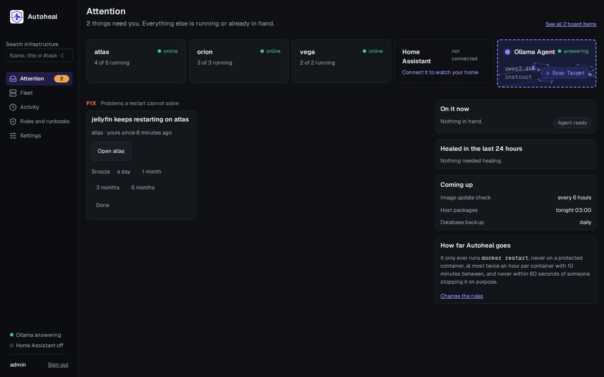
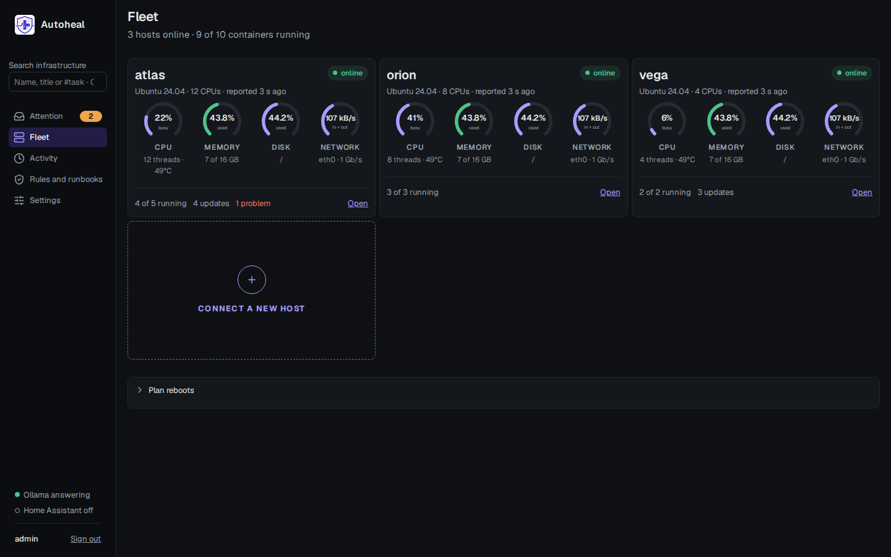
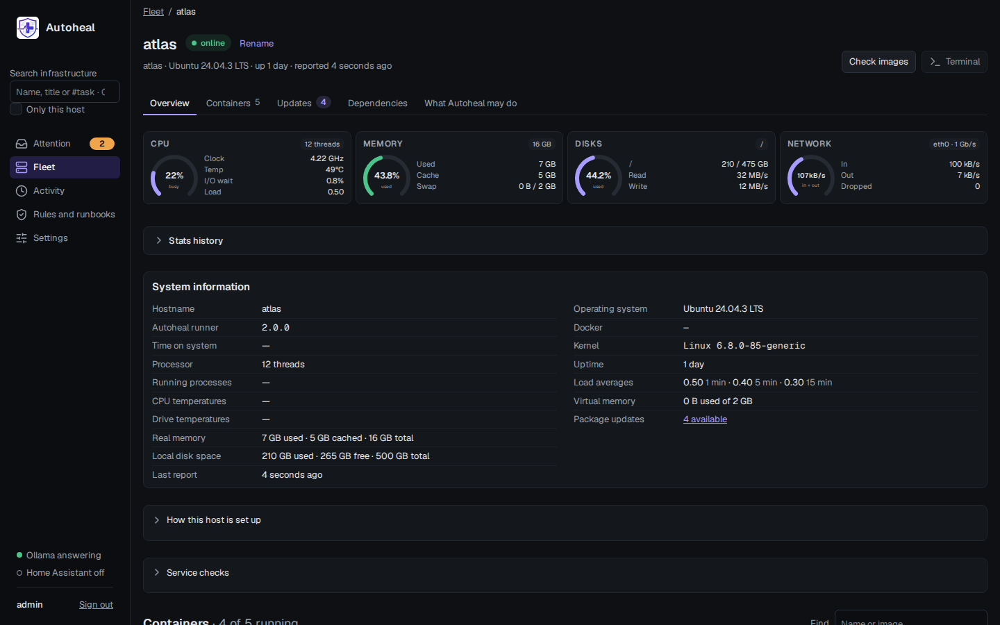
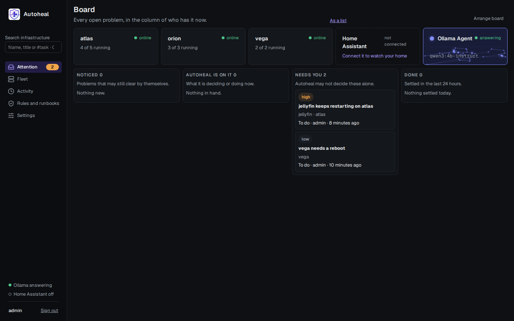
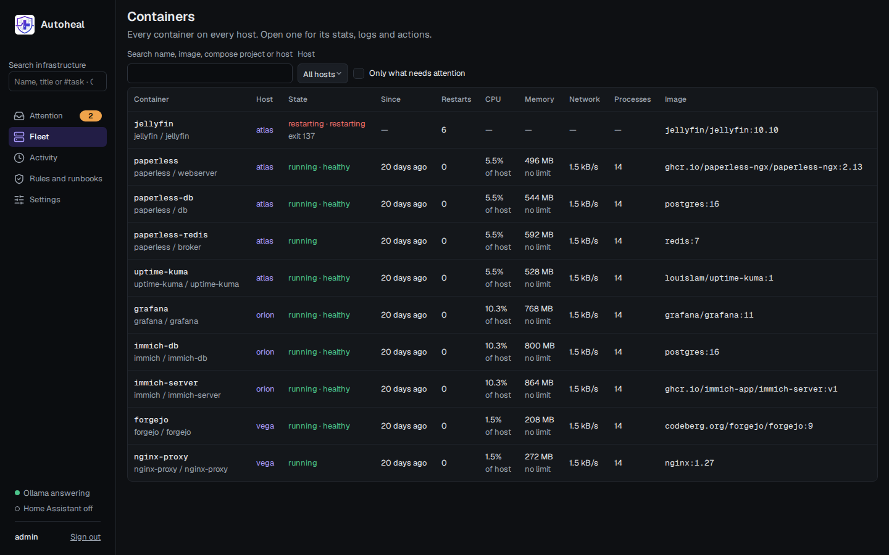
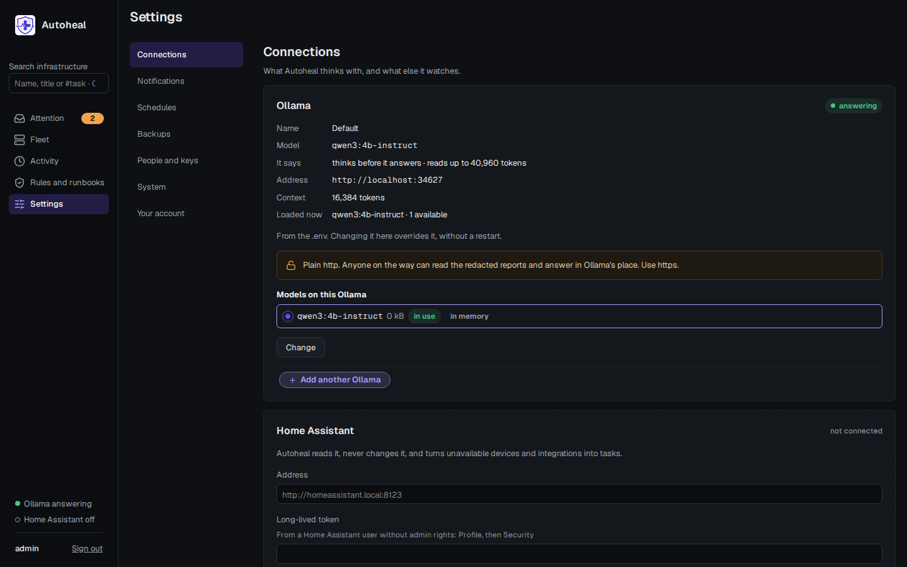

<p align="center"></p>

# Autoheal

Sees the whole home lab, heals failed Docker containers, and shows you everything it did.

It watches every host's CPU, memory, disks, network, GPU and pending updates; every container's
state, health, restarts, CPU, memory, disk and network use; and, through Home Assistant, every Zigbee device, the smoke, heat and CO
alarms, and the systems Home Assistant already watches (UniFi, Pi-hole, the Synology NAS, uptime
checks). Home Assistant is only ever read.

When a container dies, gets OOM-killed or turns unhealthy, the runner on that host:

1. Waits 30 s, so Docker's own restart policy gets a chance first.
2. Collects the state, the health-check output and the last 200 log lines, how Docker shows the other containers of its compose project and the last 30 lines of up to three of them that are down or unhealthy, and masks secrets in all of it (every container's environment values, tokens, passwords, keys).
3. Asks for ONE action from a fixed menu: `restart`, `restart_dependency` (another container of the failed one's compose project, never one outside it) or `escalate`. The control plane asks Ollama, adding your runbooks and the container's earlier incidents on that host from the last 30 days (the last 5: what was done, how each ended, and what a person chose, with their note; never the model's earlier diagnoses) what its memory and CPU did in the half hour before, as Autoheal measured them, and what changed on the host in the last day for it, its compose neighbours and the host itself; the incident's page lists the earlier incidents and charts that half hour, kept with the incident; if the control plane is unreachable, the runner asks Ollama directly; if that fails too, it escalates. A model that can think (such as `qwen3:30b-a3b`) thinks through what it reads before it answers, a minute or more a question; the incident keeps the end of that thinking (16,000 characters), and its page shows it under **See how the model reasoned**.
4. Checks the answer itself and carries out only that action, and only `docker restart`.
5. Tells you on Gotify, ntfy or a webhook: the diagnosis, and a link to the incident in the dashboard.

**The model never runs commands. It only picks from the menu, and the host checks the answer:**

- An unknown action, an unknown container, a protected container or a broken answer means `escalate`.
- At most 2 restarts per container per hour, then `escalate`. Its host's page shows, under the container's state, how many of them Autoheal used this hour, and when it may restart it again once both are used. An admin may **Reset** them there: that clears the container's restarts this hour and its 10-minute wait below, never the limits, and the runner hears of it with its next report. Only this version's runner takes a reset.
- Each container is handled at most once per 10 minutes, so a crash loop can't cause a storm. While it waits, the same line says when Autoheal looks at it again.
- A `die` right after a `kill` is you stopping it, and is ignored. Its own restarts don't re-trigger it.
- Healing never uses sudo, never edits compose or `.env` files, never pulls images and never deletes anything. Pulling an image is for updates only, and only when you ask, or when the container's own label lets Autoheal do it (see "Container actions and image updates").
- Approvals from the dashboard go through the same checks on the host. Approval is not a bypass.
- A container that exits cleanly (code 0) and has no restart policy is a job that finished (a backup, a migration, `compose run`), not a failure. It is left alone; restarting it would run the job again.

**Runner safety state after upgrading.** Restart credits, the 10-minute handling cooldown and deliberate-stop suppression survive runner/container restarts. Each runner keeps a bounded snapshot in runtime-managed `autoheal-guard-*` Docker volumes on its own engine, labelled `autoheal.guard.state=1`. This reuses the existing Docker access and journal architecture; standalone mode and the read-only Compose containers need no new writable mount or setting. The main, example and generated runner Compose templates document the retention requirement. These metadata volumes are accessible to Docker administrators, contain container names and timing/counts only, and must not be pruned or deleted during upgrades. They are not a backup of application data.

A fresh installation, upgrade from a version without guard state, or erased state starts a **one-hour safety hold** before automatic or approved incident restarts can run; the runner logs the hold, and its host shows _recovery held until_ the time it ends, on its Fleet card and its page. A restart during that hour preserves its remaining duration. This prevents deleting state from granting fresh credits. Review failed/stopped workloads during that migration period; events suppressed by the hold are not automatically replayed. Ordinary explicit container controls keep their existing authorization/protection checks. Budget counters continue to report recorded reservations; safety-state refusals have a separate explanation in operation results.

Saved snapshots are validated and read before event catch-up, include Linux boot identity, wall time and boot uptime, and expire old entries before use. Within one boot, uptime measures elapsed time even when wall time changes; reconstruction allows a conservative extra second for uptime precision. After a host reboot, elapsed wall time is used; a backwards clock preserves the remaining safety windows. A forward wall-clock correction during a different boot cannot be distinguished from genuine offline time, so keep the host clock reliable. Charges and managed stop intentions must be published and verified before mutation; failed persistence blocks recovery, and uncertain managed operations retain their existing shutdown journals. Unknown/corrupt state, unavailable boot identity/storage or exhausted state capacity refuses unsafe startup/recovery rather than silently resetting counters. While a runner cannot save its state, or its state is full, its host shows _recovery held_ and a high-priority task says what to do; both clear by themselves once the runner reports no hold. State is bounded to 4,096 active container entries and 1 MiB per snapshot; expired entries are removed and older snapshots are deleted only after the next one is verified.

Preserve and export the guard volumes before investigating a failure. Repair storage/clock problems and recover a verified snapshot; startup does not automatically overwrite malformed records. Only one runner per Docker engine is supported. External administrators can remove or replace engine metadata, so this is not a tamper-proof store. Before reverting this fix, retain the state and pause automated recovery or use a genuinely manual-only policy; older runners cannot enforce the saved budgets, and approval alone does not add persistence. Results the runner has not yet delivered are kept apart from this state, in its result journal (see **Shutdown and interrupted operations**).

## Screenshots

| Attention                                                        | Fleet                                                        |
| ---------------------------------------------------------------- | ------------------------------------------------------------ |
|  |  |

| A host                                                              | Board                                                             |
| ------------------------------------------------------------------- | ----------------------------------------------------------------- |
|  |  |

| Containers                                                        | Settings                                                                 |
| ----------------------------------------------------------------- | ------------------------------------------------------------------------ |
|  |  |

## How it fits together

```
 Control plane (one host)                     Runners (every host, same image)
 ┌──────────────────────────────────┐         ┌───────────────────────────────┐
 │ dashboard   :8443 ← you, a proxy │         │ watches the Docker socket     │
 │ runner API  :9443 ← your hosts   │◄────────┤ reports its host and all its  │
 │ SQLite: users, incidents, audit, │  HTTPS  │ containers, runs approved     │
 │ runbooks, approvals, backups     │ (pinned)│ work; protected list, budget  │
 └───────┬─────────────────┬────────┘         │ and dry-run stay on the host  │
         │                 │ read-only        └───────────────────────────────┘
         ▼                 ▼
      Ollama          Home Assistant (optional)
```

One image, `ghcr.io/aiulian25/autoheal`, runs as `control-plane` or `runner`, on amd64 only: there is no arm64 build. The control plane looks after the machine it runs on itself, and Linux hosts [over SSH](#hosts-over-ssh); a runner is for the others, such as a Synology. It is distroless, runs as UID 65532 with a read-only root filesystem and no capabilities, and is scanned by Trivy before it is published. The control plane makes its own TLS certificate; each runner knows it by the public key in its join code, so no certificate authority is needed.

The dashboard has a menu on the left, with what it leans on (Ollama, your notification channels, Home Assistant) at its foot on the home page:

- **Attention** (the home page, with the number that needs you): a line of cards with each host, Home Assistant and the Ollama Agent, then what needs you. _Decide_: what Ollama handed over, or what a container's rule asks you about first, with the guard's checks and **Approve restart**, **Restart it**, **Leave it stopped** or **Stop watching this container** right there. _Fix_: problems a restart cannot solve, such as a disk nearly full, with **Snooze a day** and **Done**. _Updates_: each host's new images and packages, Ollama's word on each image (safe to apply, or hold it for you), and **Update N containers now**; and Home Assistant's own, each with its release notes, to install in Home Assistant (Autoheal only reads it). Beside them: what Autoheal is on now, what it healed in the last day, and what comes next. **See all board items** opens the board: every open problem in the column of who has it now (_Noticed_, _Autoheal is on it_, _Needs you_, _Done_ for the last 24 hours), its steps beside it when clicked.
- **Fleet**: every host as a card with its dials, what runs and what waits there, and, at the end of the grid, a dashed **Connect a new host** tile that opens a small dialog. A click anywhere on a card opens its host. Home Assistant's own box has a card beside them once Home Assistant is connected: its CPU, memory, disk and network dials from its System Monitor integration (a dial it has no sensor for is left out; its network sensors ship switched off in Home Assistant, and the card says so; turned on there, they show within seconds, and so do memory and disk as used of the whole once their "use" sensors are on), its versions, its entities and how many are unavailable, the updates waiting for Core, its operating system, its Apps and what HACS installed, and what needs a look at home. Each host has one page with everything in one place, where an admin can also **Rename** it beside its name (letters, digits, dots, dashes and underscores, unique among hosts; its runner's reports never change it back): its state, live dials, its system information (hostname, operating system, Docker and runner versions, the host's own time, kernel and processor, temperatures, uptime, processes, load, memory, swap, disk space and package updates), its containers, its updates, what Autoheal may do there, the last 30 minutes as charts, old images, what is open on it, its recent incidents, and **What changed**: a journal, kept two weeks, of containers appearing, going, recreated (with their image before and after), restarted by Docker, stopping or starting, and the host rebooting or changing its Docker or kernel. Under its system information, **How this host is set up** shows admins what its containers have in common (user and group, time zone, restart policy, app folder, data folders and their free space, shared networks, proxies, databases). Its runner works this out only while it is open, and reads no environment value but `PUID`, `PGID` and `TZ`. **Add a container**, beside the filters above a host's containers, puts a new app there, on a runner's host or over SSH alike. Search for an app, or paste any public image name. Autoheal reads the image, without downloading it, and proposes everything from what the host's other containers do: its folder, where its data goes, who it runs as, which network and proxy, each option on the screen: a click selects it, several at once for networks, including **On the LAN** with the host's own address. **Other…** takes what was not offered. It checks the name, folder, network, port, disk and which Compose the host has before **Install** is offered. An install is ordinary files you own, `docker-compose.yml` and a `.env` (mode 600) in its own folder, then `docker compose up -d`, with `docker-compose` where a NAS has the older one. Passwords are generated on the host as the `.env` is written, so they never pass through the dashboard, and PUID, PGID and every secret stay in the `.env`. Admins only; off with `HOST_DEPLOY=off` in a host's `.env`, and not in dry-run. **Undo** takes back only what Autoheal installed, and asks about the data first. Click a container and its panel opens right under it; click it again to close it. It has its actions as named buttons (**Restart**, **Stop**, **Pause**, **Update**, **Recreate**, **Terminal**, **Files**, **Edit settings**, **Remove**), one thin line of gauges, and a tab for each topic: **Overview**, **Logs**, **Layers**, **Processes**, **Network**, **Mounts**, **Files**, **Environment**, **Labels**, **Security**, **Resources** and **Health**. The **Network** tab shows the host's networks to click: a click joins or leaves at once, without a restart. A Compose file is not changed, so a rebuild by Compose can put back what it says. Values that look like secrets stay hidden until you press show; opening Environment or Labels is noted in the audit log, and the panel needs what Edit settings needs (the host's `CONTAINER_ACCESS`, and an admin or someone granted it). **Edit settings** changes its environment, labels, ports, mounts and restart policy by recreating it on the same image, the old one kept aside until the new one runs; a Compose file is not changed, so the next `docker compose up` puts the file's values back. Overview also has its timeline, newest first: its incidents, the jobs asked of it (not log reads), what changed on it and on its host, the steps on its tasks, and the alerts about them, the last 200, each leading to its incident or task. A link that opens a container, such as **Open container** on an incident, brings it into view. Every container on every host is at `/containers`, with the same in-place stats. What you send for an install, your `.env` included, waits sealed with the backup passphrase in the database until that job has an outcome, so a restart here does not lose it; a database backup taken meanwhile holds it sealed too.
- **Activity**: incidents, each with what happened step by step (event, report, Ollama's call, the guard's checks, your decision, outcome) and its full report, and the audit log.
- **Rules and runbooks**: runbooks (your instructions to the model, versioned) and replays (re-run recent incidents, or one incident from its own page, against a draft before publishing it).
- **Settings**: connections (Ollama, with more servers each watching the hosts you tick, and Home Assistant), notifications, schedules, backups, people and keys, the system's settings, and your own account (name, password, moving your authenticator, new recovery codes, passkeys, where you are signed in, the look: light, dark, or as your device is set, and whether stop and remove ask first in that browser).

Tasks are on the board, and the page of each one at `/tasks`; Home Assistant's devices, read-only (the box it runs on first, then the safety alarms, the Zigbee mesh and what it watches), are a click on its card on Attention or on Fleet.

Every account uses a password and TOTP. Wrong codes at the two-step check count as failed sign-ins, so a stolen password does not buy unlimited guesses at the code.

**Passkeys** sign you in with your fingerprint, face or device PIN instead of the password and the code. Add one in **Settings → Your account → Passkeys**: a current code from your authenticator, then your browser's own prompt, and it names itself after the password manager that keeps it (iCloud Keychain, Google Password Manager, 1Password, Bitwarden…). From then on the sign-in page offers **Passkey**, with no name to type. A passkey must check the person (fingerprint, face or PIN), so it counts as both steps. Browsers allow passkeys only for a site reached by name with a certificate the device trusts, never at an IP address: set `PUBLIC_BASE_URL` to that name (through a [reverse proxy](#behind-a-reverse-proxy), say). A passkey works only for the name it was made at. An admin resetting someone's password or authenticator, and `reset-admin`, remove that person's passkeys.

## Install

You need Linux hosts with Docker (and its compose plugin), and an [Ollama](https://ollama.com) the hosts can reach, with the model pulled: `ollama pull qwen3:4b-instruct`.

**On the main host** (it runs the dashboard, and watches its own containers too):

1. Make a folder for it:

   ```bash
   mkdir autoheal && cd autoheal
   ```

2. Save this as `docker-compose.yml`:

```yaml
# Autoheal on its main host: the dashboard, which also looks after this machine itself, from inside its container.
# Needs a .env next to this file: copy .env.example and fill it in. Other hosts: Fleet > Add a host in the dashboard.
# Runner safety budgets use runtime-managed autoheal-guard-* Docker volumes; retain them across upgrades.
x-autoheal: &autoheal
  image: ghcr.io/aiulian25/autoheal:1
  restart: unless-stopped
  # Longer than it takes to finish what it is doing, or Docker kills it part way.
  stop_grace_period: 40s
  env_file: .env
  user: "65532:65532"
  read_only: true
  cap_drop: [ALL]
  security_opt: [no-new-privileges:true]
  # The audit trail is written here too; keep enough of it.
  logging: { driver: json-file, options: { max-size: 10m, max-file: "10" } }

services:
  control-plane:
    <<: *autoheal
    command: control-plane
    # Autoheal never acts on its own container, which it finds by the hostname Docker gives it.
    container_name: autoheal-control-plane
    group_add: ["${DOCKER_GID:?set DOCKER_GID in .env: stat -c %g /var/run/docker.sock}"]
    ports:
      # The dashboard, and the runner API your other hosts report to. LAN_ADDRESS keeps both to one address.
      - "${LAN_ADDRESS:-0.0.0.0}:8443:8443"
      - "${LAN_ADDRESS:-0.0.0.0}:9443:9443"
      # The router's log export, for firewall evidence and who talks to whom. Off unless ROUTER_LOG_PORT is set too.
      # - "${LAN_ADDRESS:-0.0.0.0}:5514:5514/udp"
    volumes:
      - data:/data
      # Where an older install's runner joined from: this machine's host, with its history, is taken over from it.
      - join:/join
      # This machine, looked after in place. Root-equivalent: ":ro" would not make the API read-only, so it is not
      # pretended here. Without it, the dashboard runs alone and this machine needs a runner of its own.
      - /var/run/docker.sock:/var/run/docker.sock
      # The host's own files, read-only: its name, disk usage, and whether a reboot or updates wait.
      - /:/host/root:ro
      # Any folder of the host can be mounted here the same way. This one lets Ollama read Home Assistant's
      # configuration, to explain errors and suggest automations and clean-ups: set HOME_ASSISTANT_CONFIG_PATH in
      # .env. Read-only: Autoheal only suggests. "rslave" follows a network share that mounts after this starts.
      - ${HOME_ASSISTANT_CONFIG_PATH:-/dev/null}:/ha-config:ro,rslave
    tmpfs: [/tmp:size=64m]
    # The dashboard's, and this machine's runner's, which runs inside it.
    mem_limit: 704m
    cpus: 1.5
    pids_limit: 320

volumes:
  data:
  join:
```

3. Save this as `.env`, with your own addresses. `DOCKER_GID` is the number `stat -c %g /var/run/docker.sock` prints.

```bash
PUBLIC_BASE_URL=https://your-server-address:8443
OLLAMA_URL=http://your-ollama-address:11434
DOCKER_GID=
```

<details>
<summary>Every other setting, all optional</summary>

This is [.env.example](.env.example), which you can also copy as your `.env`:

```bash
# Autoheal. Copy this to .env next to docker-compose.yml, then run: chmod 600 .env
# Fill in the three settings under "Required". Everything else is optional: uncomment what you want to change.
# Settings in the dashboard also holds Ollama, the notification channels and Home Assistant.

# --- Required ---------------------------------------------------------------------------------------------------------

# The address you open the dashboard at: this machine's address on port 8443, or your reverse proxy's.
PUBLIC_BASE_URL=https://your-server-address:8443
# Your Ollama. https:// is better on a shared network; http:// works, and the dashboard says what it exposes.
OLLAMA_URL=http://your-ollama-address:11434
# The group that owns the Docker socket on this machine. Find it with: stat -c %g /var/run/docker.sock
DOCKER_GID=

# --- Publishing -------------------------------------------------------------------------------------------------------

# Publish the dashboard and the runner API on this address only (all addresses when unset).
# LAN_ADDRESS=
# Your reverse proxy's addresses or CIDR ranges, comma separated, so it may pass the client's address on.
# TRUSTED_PROXY_ADDRESSES=
# Receives the router's log export. Uncomment the port in docker-compose.yml too.
# ROUTER_LOG_PORT=5514

# --- What Autoheal may do on this machine -----------------------------------------------------------------------------

# 1 only reports what it would do. 0 lets it act, and lets you add containers from the dashboard.
# DRY_RUN=1
# Containers Autoheal never touches, comma separated. It never touches itself.
# PROTECTED_CONTAINERS=
# off keeps admins from adding containers to this machine from the dashboard.
# HOST_DEPLOY=on
# off keeps admins from reaching inside this machine's containers from the dashboard.
# CONTAINER_ACCESS=on
# off keeps admins from opening a shell on this machine from the dashboard.
# HOST_TERMINAL=on
# check lets Autoheal check this machine's OS packages. apply also lets it update them.
# HOST_PACKAGES=off
# How much writable data, in GB, an update copies aside first. 0 turns this off.
# UPDATE_CHECKPOINT_LIMIT_GB=2

# --- About this machine -----------------------------------------------------------------------------------------------

# The name this machine takes (its own hostname when unset).
# HOST_LABEL=
# Filesystems to report disk usage for, comma separated (every local disk when unset).
# HOST_FILESYSTEMS=/
# Where this machine keeps its D-Bus socket, if not the usual place.
# HOST_DBUS_DIRECTORY=/run/dbus

# --- Ollama -----------------------------------------------------------------------------------------------------------

# A bigger model diagnoses better, and one that thinks better still, if slower.
# OLLAMA_MODEL=qwen3:4b-instruct
# OLLAMA_CONTEXT_TOKENS=16384

# --- Backups ----------------------------------------------------------------------------------------------------------

# Your own, of 32 or more characters, or another installation's to restore its backups (made on the first start).
# BACKUP_PASSPHRASE=
# A second copy of every backup, in a folder mounted into the container.
# OFFBOX_BACKUP_DIRECTORY=

# --- Your own certificate (Autoheal makes one when unset) -------------------------------------------------------------

# TLS_CERTIFICATE_FILE=
# TLS_KEY_FILE=

# --- Notifications and Home Assistant: set here, they are fixed in Settings -------------------------------------------

# GOTIFY_URL=
# GOTIFY_TOKEN=
# NTFY_URL=
# NTFY_TOPIC=
# NTFY_TOKEN_FILE=
# HOME_ASSISTANT_URL=
# The token file must be readable by UID 65532.
# HOME_ASSISTANT_TOKEN_FILE=
# Home Assistant's configuration folder on this machine, mounted read-only so Ollama can explain errors and suggest
# automations. secrets.yaml and .storage are never opened.
# HOME_ASSISTANT_CONFIG_PATH=
```

</details>

4. Start it, and read the first sign-in password from its log:

   ```bash
   chmod 600 .env
   docker compose up -d
   docker compose logs control-plane | grep "First run"
   ```

`PUBLIC_BASE_URL` is the address you will open the dashboard at (this machine's, on port 8443), and `OLLAMA_URL` your Ollama's.

Open the dashboard. The browser warns about the certificate the first time: Autoheal made it itself (see [Your own certificate](#your-own-certificate) to avoid that). Sign in as `admin` with the one-time password from the log, choose a password and set up two-step sign-in. Save the recovery codes, and the **backup passphrase** shown next to them: every backup is encrypted with it, and nothing else opens one. The authenticator entry is named after `PUBLIC_BASE_URL`'s host, so entries from different instances don't look alike, and carries Autoheal's logo for the apps that read one from the link, such as FreeOTP: the phone fetches it from the dashboard when you scan, so it needs to reach that address then. Most others, Google and Microsoft Authenticator among them, show their own icon or the name's first letter.

This host is already on the board: the dashboard's container looks after it from inside, through the Docker socket and the host's files mounted into it, with no second container. Its settings are this `.env`'s, as a runner's would be (`DRY_RUN`, `PROTECTED_CONTAINERS`, `HOST_PACKAGES`…), and Autoheal never acts on its own container. If you revoke it, the Fleet page offers admins **Add this machine again**: the same host, with its name, choices and history, gets a new token, and is looked after again within a minute.

**On every other host**: in the dashboard, click **Fleet → Connect a new host**. A Linux machine is best added [over SSH](#hosts-over-ssh): nothing is installed on it, and it needs no Docker. **Runner container** (a Synology, or wherever you prefer one) gives a command to paste on that host (with `sudo` where `docker` needs it). It writes a `docker-compose.yml` and an owner-only `.env` holding the host's join code, starts the runner, and the host shows up within seconds.

**Go live when you trust it.** A runner starts in dry-run: it reports "would restart" and changes nothing. Read its reports for a while; when the decisions look right, add `DRY_RUN=0` to that host's `.env` and run `docker compose up -d` there. Only the host can switch itself to live; the dashboard cannot.

**Notifications and Home Assistant** are set up in **Settings → Notifications** and **Settings → Connections**, each with its address and token, with **Send a test** for Gotify, ntfy and the webhook. For Home Assistant, make a user without admin rights (Settings → People → Users, with **Advanced mode** on in your profile: name it `autoheal`, leave **Administrator** off, tick **Can only log in from the local network**), sign in as it in a private window, and create a long-lived token under **Profile → Security**. Autoheal only ever reads Home Assistant.

**Updating Autoheal**: on the main host, **Settings → System → Update Autoheal**. It pulls the image `AUTOHEAL_IMAGE` names (an image built or loaded on this machine is used as it is), then a one-shot helper of that image replaces the dashboard's container with everything it was given: its mounts, networks, ports and environment. The old one is stopped first and the database copied and checked, so the update needs room for one more copy of it. If the new one does not become healthy within three minutes, or stops being healthy within ten, the helper stops it and starts the old one again, and the card says so. If the new one migrated the database, the old version cannot open it, so the copy goes back first and changes made since the update are lost; otherwise those changes stay. Once the new one has held, the old container and the copy are removed. If an update stops partway, Update Autoheal takes it up again. If the dashboard itself is down, `self-update.json` in the data volume says how far it got, and running `main.js self-update <original container id> <image id> <reference>` from those values, as the card's helper does, does the same. `docker compose pull && docker compose up -d` still works as well. SSH hosts follow by themselves, since their runners run inside the dashboard. A runner host on another version says so on its page, with the command to run in its runner's folder.

**From an install with a runner beside the dashboard**: replace your `docker-compose.yml` with the new one, keeping your `.env`, then `docker compose up -d --remove-orphans`. The dashboard takes over this machine's host, with its history, and the old runner's token stops working; until its container is gone the host's page says it waits, so two never look after the same containers. `--remove-orphans` removes it.

### Optional settings

Everything else has a default. Put what you change in the `.env` of the host it is about, then run `docker compose up -d` there.

| Setting                                           | Where        | Default                      | What for                                                                                                                                                                                                                                                                                                                                                                                                                                                                                                           |
| ------------------------------------------------- | ------------ | ---------------------------- | ------------------------------------------------------------------------------------------------------------------------------------------------------------------------------------------------------------------------------------------------------------------------------------------------------------------------------------------------------------------------------------------------------------------------------------------------------------------------------------------------------------------ |
| `DRY_RUN`                                         | each host    | `1`                          | `0` lets that host's runner act                                                                                                                                                                                                                                                                                                                                                                                                                                                                                    |
| `PROTECTED_CONTAINERS`                            | each host    | none                         | Containers Autoheal never touches, comma separated (it never touches itself)                                                                                                                                                                                                                                                                                                                                                                                                                                       |
| `HOST_FILESYSTEMS`                                | each host    | every local disk             | Filesystems to report disk usage for, as host paths (`/,/mnt/data`)                                                                                                                                                                                                                                                                                                                                                                                                                                                |
| `HOST_LABEL`                                      | each host    | the host's own name          | The name a host added without one takes                                                                                                                                                                                                                                                                                                                                                                                                                                                                            |
| `HOST_PACKAGES`                                   | each host    | `off`                        | `check` lets Autoheal check that host's packages, `apply` also update them: [OS updates](#os-updates)                                                                                                                                                                                                                                                                                                                                                                                                              |
| `HOST_DBUS_DIRECTORY`                             | each host    | `/run/dbus`                  | Where that host keeps its D-Bus socket, if somewhere else                                                                                                                                                                                                                                                                                                                                                                                                                                                          |
| `CONTAINER_ACCESS`                                | each host    | `on`                         | `off` keeps admins from reaching inside that host's containers from the dashboard: [shell, files, settings](#inside-a-container-shell-files-settings)                                                                                                                                                                                                                                                                                                                                                              |
| `HOST_TERMINAL`                                   | each host    | `on`                         | `off` keeps admins from opening a shell on that host itself from the dashboard: [a terminal on the host](#a-terminal-on-the-host)                                                                                                                                                                                                                                                                                                                                                                                  |
| `HOST_DEPLOY`                                     | each host    | `on`                         | `off` keeps admins from adding containers to this host from the dashboard.                                                                                                                                                                                                                                                                                                                                                                                                                                         |
| `UPDATE_CHECKPOINT_LIMIT_GB`                      | each host    | `2`                          | How much writable data (GB) an update checkpoints; `0` disables checkpoints. Automatic undo requires a complete checkpoint for stateful containers; a manual update may proceed with the displayed warning, but downgrade is blocked without one                                                                                                                                                                                                                                                                   |
| `LAN_ADDRESS`                                     | main host    | all addresses                | Publish the dashboard and the runner API on this address only                                                                                                                                                                                                                                                                                                                                                                                                                                                      |
| `TRUSTED_PROXY_ADDRESSES`                         | main host    | none                         | Your reverse proxy's addresses (IPs or CIDR ranges), so it may pass the client's address on. Wins over a list set in Settings → System                                                                                                                                                                                                                                                                                                                                                                             |
| `OLLAMA_MODEL`, `OLLAMA_CONTEXT_TOKENS`           | main host    | `qwen3:4b-instruct`, `16384` | A bigger model diagnoses better, and one that thinks better still, if slower; replay shows how its decisions differ before you switch (**Rules and runbooks → Replays**: choose a model the same Ollama has and how many recent incidents, then **Use … from now on** on the run if it does better). **Settings → Connections → Ollama** overrides these and `OLLAMA_URL` without a restart, once that Ollama answers with the model, the model can answer chats and reads that much; **Use the .env's** goes back |
| `OFFBOX_BACKUP_DIRECTORY`                         | main host    | none                         | A second copy of every backup, for example an NFS share mounted into the container                                                                                                                                                                                                                                                                                                                                                                                                                                 |
| `BACKUP_PASSPHRASE`                               | main host    | made on the first start      | Your own (32+ characters), or another installation's, to restore its backups                                                                                                                                                                                                                                                                                                                                                                                                                                       |
| `TLS_CERTIFICATE_FILE`, `TLS_KEY_FILE`            | main host    | made on the first start      | [Your own certificate](#your-own-certificate)                                                                                                                                                                                                                                                                                                                                                                                                                                                                      |
| `GOTIFY_URL`, `GOTIFY_TOKEN`                      | main host    | Settings                     | Set here, they are fixed in Settings. On another host: that runner's own alerts while the main host is down                                                                                                                                                                                                                                                                                                                                                                                                        |
| `NTFY_URL`, `NTFY_TOPIC`, `NTFY_TOKEN_FILE`       | main host    | Settings                     | Set here, they are fixed in Settings                                                                                                                                                                                                                                                                                                                                                                                                                                                                               |
| `HOME_ASSISTANT_URL`, `HOME_ASSISTANT_TOKEN_FILE` | main host    | Settings                     | Set here, they are fixed in Settings; the token file must be readable by UID 65532                                                                                                                                                                                                                                                                                                                                                                                                                                 |
| `OLLAMA_URL`                                      | another host | the main host's              | Where that runner asks Ollama itself while the main host is down                                                                                                                                                                                                                                                                                                                                                                                                                                                   |

`http://` addresses work for Ollama, Home Assistant, Gotify, ntfy and the webhook; the dashboard then says what that exposes on your network (the logs sent to Ollama, a token). `https://` is better wherever others share the network. Runners always talk to the control plane over TLS.

### Behind a reverse proxy

Point npm, Traefik, Caddy or a tunnel at `https://<main host>:8443`. The certificate there is Autoheal's own, so tell the proxy not to check it (npm doesn't by default), or use [your own certificate](#your-own-certificate). Set `PUBLIC_BASE_URL` to the address people type (`https://autoheal.example.org`), then trust the proxy so Autoheal records each person's own address (in sessions, the audit log and the sign-in limits) instead of the proxy's: **Settings → System → Trusted proxies** shows the address your own request came through, with a button to trust it. That address is not always the proxy's own: a proxy in a container on the same machine that reaches port 8443 by the machine's address comes through Docker's port relay, the gateway of Autoheal's Docker network. Settings refuses ranges wider than /8 (IPv6: /16); `TRUSTED_PROXY_ADDRESSES` in the `.env` wins over the list there, and fixes it. The proxy must pass on the original `Host` (or `X-Forwarded-Host`). Keep port 9443 on your LAN: runners use it, people never do. **Connect a new host** offers runners that name on port 9443, which works where the name leads to this machine on your LAN (a local DNS entry does it); where it leads to the proxy instead, put the machine's own address there, and the next host is offered it again until `PUBLIC_BASE_URL` changes.

### Your own certificate

IPv6 literals in URLs need brackets, for example `PUBLIC_BASE_URL=https://[fd00::5]:8443`. Autoheal's generated certificate includes that IPv6 address as an IP subjectAltName; compressed and expanded spellings identify the same address. Upgrading an existing IPv6 installation may renew its generated certificate once to add the address, keeping the stored private key and runner pins. Avoiding the self-signed trust warning still requires a certificate your devices trust. IPv6 reachability depends on your existing host/network configuration; this does not change listeners or port publishing.

To skip the browser warning, give the control plane a certificate your devices trust: mount it (for example `- ./certs:/certs:ro` under `control-plane` in `docker-compose.yml`) and set `TLS_CERTIFICATE_FILE=/certs/control-plane.pem` and `TLS_KEY_FILE=/certs/control-plane-key.pem`, the key readable by UID 65532. Runners added before keep working while the key stays the same, and a runner whose host trusts your CA keeps working even when it changes. [certs/README.md](certs/README.md) shows how to make a small private CA, and how to put Ollama and Home Assistant behind TLS.

### Disks and drive temperatures

Each runner reports every local disk its host has mounted, as `df` lists them (loop devices and network shares left out, a ZFS pool once), unless `HOST_FILESYSTEMS` names the ones to report. A disk mounted after the runner started shows once the runner restarts. Drive temperatures come from the kernel's own sensors, NVMe drives always, and for SATA drives from what smartd last read (every half hour, where `smartmontools` is installed: Debian and Ubuntu keep its readings in `/var/lib/smartmontools`), or from the kernel once the host loads the `drivetemp` module (`echo drivetemp | sudo tee /etc/modules-load.d/drivetemp.conf`, then `sudo modprobe drivetemp`). Where smartd runs, Autoheal also reads its records of each drive, SATA and NVMe: reallocated, pending and unreadable sectors, failed self-tests, its error log, an NVMe drive's wear and spare blocks, and smartd's own warnings, which otherwise go to a `mail` most hosts do not have. The host's page lists each drive's health with the age of its reading, and a task opens for a drive that shows wear (medium) or failure (high, also for a smartd warning in the last week), for a drive above the limit it declares (70 °C where it declares none) for 10 minutes, and for a GPU above 85 °C for 5 minutes. An error log alone opens nothing: NVMe drives also log harmless entries. smartd files an NVMe drive's every critical warning, heat included, as a health warning; where its attribute log shows the last week's were heat alone (smartmontools 7.5 and later keep one for NVMe drives), they count as heat, not failure, as Netdata counts them: the host's page notes them beside the drive, and heat opens its own task once the drive stays above its limit. The CPU temperatures are each core's, or each reading the CPU's sensor has. The address next to the host's name is its IPv4 address on its default route.

### The GPU dial

Intel and AMD GPUs need nothing: every kind of host finds them in the kernel's own files and shows each with its dial, within seconds of the runner starting, so a card added later shows once the host is back up. A card asleep is not woken to be read, and shows as idle. Each driver gives what can be trusted: AMD's its busy share, memory, power and temperature; Intel's built-in GPUs (`i915`) their busy share; Intel's Arc cards (`xe`) their temperature, and, as their idle and energy counters jump, a dial that says how close to its top clock the card runs, not how busy it is, with no power or memory. Autoheal carries its own list of Intel and AMD GPU names, so a host's older list does not matter; a card newer than both shows by its number.

An NVIDIA GPU's dial needs its runner to have the card, for `nvidia-smi` only, through the [NVIDIA Container Toolkit](https://docs.nvidia.com/datacenter/cloud-native/container-toolkit/). The install command from **Connect a new host** gives it on a host with an NVIDIA card and the toolkit, unless the machine's chassis type says it is a laptop: asking a laptop's GPU every 5 s keeps it awake. Where a runner still has no card, its host's page says so under the dials, with one paste to run where the runner's `docker-compose.yml` is. It writes this as `compose.override.yaml`, which Compose reads by itself, never over one already there, and restarts the runner:

```yaml
services:
  runner:
    environment:
      NVIDIA_DRIVER_CAPABILITIES: utility # nvidia-smi only, nothing for computing on the GPU
    deploy:
      resources:
        reservations:
          devices:
            - { driver: nvidia, count: all, capabilities: [gpu] }
```

On a laptop, add the same by hand if you want its dial.

### Pinning the image

The compose files pull the newest `1.x`. Each release is also tagged with its own version (`1.1.0`, `1.1`), and the newest code on `main` is `latest` and `main`, which may be less tested. To run exactly what CI scanned, pin the digest from its run summary (`image: ghcr.io/aiulian25/autoheal:1@sha256:…`), and check where it came from first: `gh attestation verify oci://ghcr.io/aiulian25/autoheal@sha256:… --owner OWNER`.

## Hosts over SSH

Any Linux machine can be added without installing anything on it. The control plane signs in over SSH with your key, as your own user, and runs that machine's runner itself. Over that one session it reads the machine's system (load, memory, CPU, disks, temperatures, drives, packages), and, where the machine runs Docker your user may use, looks after its containers too, through Docker's socket reached over the same session. Everything a runner host has works the same way: healing, the board, actions, updates, shells, files and settings.

**What the machine needs:**

- OpenSSH's server, reachable from the control plane's host on port 22 or the one you give. The control plane only dials out: nothing new listens anywhere.
- Your user, with your public key in its `~/.ssh/authorized_keys`.
- **Docker is optional.** Without it the machine is watched for its system alone, and its containers show by themselves once Docker is installed and your user may use it. For its containers your user must be able to use `/var/run/docker.sock`, which the `docker` group gives: `sudo usermod -aG docker <user>`, sign out and in, and `docker ps` then works without `sudo`.
- For operating system updates only: the machine's root password, or your user's when it may use `sudo`, saved on its page (below).

**Adding one: Fleet → Connect a new host**, Connection **SSH**, in one dialog:

1. **Where it is:** a name, the address, the port and your user.
2. **Your key:** choose one Autoheal keeps already, **Paste a private key…** (ed25519, ECDSA or RSA) with its passphrase if it has one, or **Make a new key…**: an ed25519 key, encrypted with the passphrase you give it as `ssh-keygen` would (leave it empty for none), and what to run on the machine as your user, each line with a copy button:

   ```bash
   mkdir -p ~/.ssh && chmod 700 ~/.ssh
   echo 'ssh-ed25519 AAAA… autoheal@mini' >> ~/.ssh/authorized_keys && chmod 600 ~/.ssh/authorized_keys
   sudo usermod -aG docker alex   # only for its containers, and only if the user is not in the group yet
   docker ps                        # works without sudo once it is
   ```

   The second line is also offered with `from="<the dashboard's address>"` in front, so that the key works from the dashboard alone. OpenSSH matches a name there only when the machine's `sshd` has `UseDNS yes`, so take that line when the dashboard's address is an IP address. **Download the private key** gives you a copy, once.

   The same lines are under **Show the commands that let this key in on the host** for a key Autoheal already keeps.

3. **Test connection:** the control plane signs in and says whether Docker is there and usable by your user. It then shows the fingerprint of the host key the machine offered. Compare it with what the machine itself prints, `ssh-keygen -lf /etc/ssh/ssh_host_ed25519_key.pub`, then **Trust and add host**. An unreachable machine, a refused key or a wrong passphrase is said in the dialog, with what to do. **Cancel**, or Escape, removes the keys given or made in that attempt.

The host shows on Fleet with its first report, within seconds. Keys and their passphrases are kept sealed with the backup passphrase and never shown again. **Settings → People and keys → SSH keys** lists them and the hosts each signs in to; one in use cannot be removed.

**Its page** has an **Over SSH** card:

- how it signs in, its key, and the host key it trusts;
- **Sign in with another key**;
- **Root commands**;
- **Settings**: what a runner's `.env` says, kept here for this host. That is dry run, protected containers, shells, files and container settings, operating system packages, and the data kept aside before an update. Like a new runner, an SSH host starts in dry run: untick it there to go live. Unlike a runner host, it is the dashboard that decides this, not a file on the machine.

**A changed host key** stops Autoheal connecting. The card then shows both fingerprints: compare the new one on the machine, then **Trust the new key**. There is no "accept any key".

**Root commands and OS updates.** Save the machine's root password, or your user's when it may use `sudo`, under **Root commands**, any time. It is checked on the machine first (`sudo`, then `su`), sealed, never shown again, and never put on a command line. Autoheal then runs the [OS update](#os-updates) jobs there as root by itself, with or without Docker on the machine. They are the same jobs as on a runner host: the same `autoheal-packages.service` unit, its log in `/var/log/autoheal`, the same window and the same rules. **Operating system packages** in the card's settings takes the place of `HOST_PACKAGES`. Without a saved password, each job is refused, saying where to save it.

**What differs from a runner host:**

- **Updates keep no copy of a container's data yet.** An update by hand goes ahead without it ("no data copy on this host yet"). An automatic update of a container with data is refused before anything stops, and waits for you.
- **Application backups run in Autoheal's own image**, which an SSH host does not have until you load it once. Load the image the control plane runs (`AUTOHEAL_IMAGE`): `docker save <image> | ssh <user>@<host> docker load`. Until then a backup is refused before anything stops, saying so.
- **Without Docker there are no containers**, so container actions are refused.
- Each SSH host's runner runs in the control plane's container. Watch that container's memory as hosts are added, and give it more when it needs it.

**Switching a runner host to SSH.** On a runner host's page, **Switch to SSH** asks where it is and which key, as above, and keeps the host itself: its name, history, tasks and incidents, and what its runner's `.env` said (dry run, protected containers, container access, packages). Once you trust its host key, the runner's token stops working. Then, on the machine, run `docker compose down` in the runner's folder (`autoheal`). Until that container is gone, Autoheal waits and says so on the page, so two never look after the same containers; it takes over within a minute after. The machine the dashboard runs on is not offered this.

**A Synology or another NAS keeps a runner, for its containers only.** DSM has no systemd, apt or dnf, so there are no OS updates to run there. In **Connect a new host → Runner container**, tick **A Synology or another NAS** and check its folder, `/volume1/docker/autoheal` unless you change it. The command then runs under `sudo`, in that folder, with `docker compose` or `docker-compose`, whichever it has, and starts without a CPU limit where the machine's kernel refuses one. Its compose file mounts the Docker socket and not the machine's `/`, so its page shows its containers, their stats and incidents, and CPU and memory, with no disks and no OS updates. If nothing can download your image, because you built it yourself, the dialog first gives the command that makes `autoheal-image.tar.gz`, to copy into that folder: the paste loads it from there.

**Checking the sessions:** on the main host, `docker exec autoheal-control-plane /nodejs/bin/node /app/dist/server/main.js self-test` says, after its own checks, how each SSH host's session stands (`connected`, `unreachable`, `authenticationFailed`, `hostKeyChanged`…, with the reason). A host that is down is reported, and the test still passes.

## Tasks

A task is one piece of work: a status, a priority, one assignee (a person, or Autoheal), sub-tasks, blockers, labels, comments and an activity timeline. You create them, and rules called detectors open them:

| Detector                                                    | Opens a task when it lasts                          | Priority                                      |
| ----------------------------------------------------------- | --------------------------------------------------- | --------------------------------------------- |
| A container crashed, keeps restarting, unhealthy            | 2 minutes (the runner tries first)                  | medium, high                                  |
| A host's runner stopped reporting                           | 3 minutes without a heartbeat                       | high                                          |
| A runner lost Docker's events (healing paused)              | 2 minutes                                           | high                                          |
| A disk 90% full (95%)                                       | at once                                             | medium (high)                                 |
| Memory or CPU above 90%                                     | 10 minutes                                          | medium                                        |
| A CPU at 85 °C                                              | 5 minutes                                           | high                                          |
| A reboot pending, or a newer kernel installed               | at once                                             | low                                           |
| A release's security fixes end within 6 months              | at once                                             | low; medium on paid support only, high after  |
| A Zigbee device unavailable; five or more                   | 30 minutes; 5 minutes, as one "Zigbee network" task | medium; high                                  |
| A Zigbee battery at 20% (10%), a weak link                  | at once; 4 hours                                    | low (medium); low                             |
| A smoke, heat or CO alarm with any problem                  | 2 minutes (an alarm: at once)                       | urgent                                        |
| An Uptime Kuma, ping, UniFi or Pi-hole problem              | 5 minutes                                           | medium                                        |
| Ollama not answering, or its model missing                  | 3 minutes; at once                                  | high                                          |
| An image update                                             | at once                                             | low                                           |
| Home Assistant's own updates (Core, its system, Apps, HACS) | 5 minutes, as one task                              | low                                           |
| Packages pending on a host                                  | at its check                                        | low; medium when a security fix waits for you |

A problem seen again joins its open task. When it clears, the task closes on its own, unless someone moved it to in progress, blocked or in review; then it only says so. A problem back within a day reopens its task. A task you close while its problem goes on stays closed until the problem ends and comes back: closing it is how you say "I know". A healing incident opens its container's task, or joins it. **Snooze** puts a task off for a day or for 1, 3 or 6 months (a month here is 30 days): until then it waits among what was noticed and sends nothing, then it needs you again (**Wake it now** on the task brings it back sooner). The almost-full disks banner on a host offers the same for the disks it names, and leaves out a snoozed disk; the disk gauges keep showing how full it is.

New and reopened tasks from medium priority up go to Gotify, ntfy and the webhook (**Settings → Notifications**), and a tap opens the task. High and urgent ones also say when they are over. Every incident a runner handles goes there too, through the control plane. ntfy shows Autoheal's logo on each one; Gotify shows the icon of its application, so upload the logo there (`https://<dashboard>/brand/autoheal-192.png`) under **Apps**.

**A webhook** sends the same alerts anywhere else: paste a webhook address in **Settings → Notifications → Webhook** and choose its format. **JSON** posts `title`, `message`, `priority` (`low`, `medium`, `high` or `urgent`) and `link`, for n8n, a Home Assistant automation's webhook trigger or your own receiver. **Discord** posts an embed that cannot ping anyone. **Slack** posts a line with its link, which Mattermost and Rocket.Chat take too. A token, if you give one, goes as `Authorization: Bearer`. Discord's and Slack's addresses hold their key, so Autoheal keeps the address sealed, shows it only up to its host, and leaves the rest out of the audit log: paste it again to change anything. The webhook is set in the dashboard only, not in the `.env`.

## Container actions and image updates

Each container on its host's page and in its task has its actions: restart, start, stop, pause and unpause, remove (a running one is stopped first; never its volumes), recent logs (secrets masked), update, and roll back after an update. On the host's page each row has them as small buttons, beside the ports it publishes (each a link to it on its host), with [a shell, its files and its settings](#inside-a-container-shell-files-settings) where its host allows them; tick several to act on them at once: the bar above the table offers each action for the ticked containers it fits (a stop for the running ones, a removal for any), and says how it went. They run on the click: only **Roll back**, which puts a container's data back as it was, asks first. Admins may run all of them, ticked containers too. A viewer may run those an admin granted them on that container, its stack or its host, one container at a time (see **Scoped operator access** below). To have a stop or a removal ask once first too, the ticked ones together, tick **Ask before stop and remove** in **Settings → Your account**: it holds in that browser only, and is off until chosen there. The host's runner takes them within a second, runs up to three at a time (unrelated container groups can run together; overlapping groups wait their turn), and still has the last word: protected containers and the runner itself are never changed, and in dry-run nothing is. For those the dashboard offers only **Logs**, and says why.

**Stacks.** On a host's page, each Compose stack's header row says how many of its containers are up (running, and healthy where they have a health check), and offers **Restart stack**. That restarts the stack's containers Autoheal may change one at a time, those the others depend on first: Compose's `depends_on`, `network_mode: container:<name>` and the `autoheal.depends-on` label give the order, and the rest go by name. Each starts once the one before has restarted; the first that fails stops the rest, and the row says where and why until that container is up again. Admins may use it, and so may a viewer whose grants let them restart every container it would restart. Compose's `depends_on` is read by this version's runner, so until a host has it, that host's stacks restart by name. A restart of the control plane part-way does not end a stack restart: it carries on from where it was, with no container restarted twice. A database restore does end it, saying so, and the containers not yet restarted are left as they were.

**A stack that differs from its files.** Every 10 minutes each runner compares its Compose stacks with their files, by one read-only script however many it has, and a stack that differs gets a **Differs from its files** button on its row, for admins. Opened, it says which services differ and how: its files changed since the container was made, its container was changed by hand or by another tool, a declared service has no container, or a container's service is no longer in the files. It shows names only: values stay on the host, and what reaches the control plane is the names plus a revision keyed with a secret that never leaves the runner. Nothing changes until someone asks **Recreate from its files** and confirms. The runner then compares afresh and refuses if anything differs from what was read, values included, recreates only the services that differ, and refuses a stack with a protected container or on a host that only watches. A leftover container is left alone. A runner restart makes an open review stale, so read it again after one.

**Service checks.** On a host's page, **Service checks** lets an admin have Autoheal ask whether a service answers: a web address giving the answer you expect, a port accepting, or a name resolving, optionally through a DNS server you name and to an address you expect. Each check runs from where Autoheal runs, not from the host, and every 30 seconds to an hour. You choose what each check may reach: this machine, your local network or the internet. Autoheal holds it to that at every check, whatever the name resolves to by then, connects only to the address it just approved, never follows a redirect, and never reaches a cloud metadata address. There are no scripts, and web addresses carry no passwords or query strings. A service counts as down after the failures in a row you set, and as back after two answers in a row, and only those changes open or close a task, which notifies as any task does. A check that fails never restarts anything, and its task goes to a person. During a maintenance window over the whole host nothing is asked or counted, an open task stays as it is, and no new one opens. The panel shows availability and answer time for the last day and 30 days, an optional target, and how much of the time no check ran. A **Certificate** check connects, sends nothing but the handshake, and looks at the certificate an endpoint presents: its dates, the name clients ask for, and its chain against the usual authorities or a private authority or self-signed certificate you name. Whether the endpoint answers and whether its certificate is good are judged apart. One that is expiring within the days you set, expired, for another name or untrusted opens one task for that check and certificate, which clears only when a check sees a good certificate, and never while the endpoint cannot be reached. Autoheal does not renew certificates.

**Reboot plans.** On the Hosts page, **Plan reboots** lets an admin reboot several hosts one at a time, in the order they tick them, without taking too many down together. You say how many of them must stay healthy, and optionally which service checks must be answering, how long each host has to come back, and when it may start. You review what is true now and approve one plan, which then never changes. Before each reboot it asks again: the host and enough others must have reported in the last minute, none on its way down or still starting, and each required check must have really answered recently. After each reboot it waits for that host's new boot, and for an answer from each check given since then. Anything unclear pauses it and opens a task, and nothing more is rebooted until someone resumes or cancels. Resuming never asks a host twice: a reboot already asked is followed, and only one the host really refused is asked again. Cancelling stops what has not begun. A reboot already asked cannot be taken back, so it goes on and stays followed. A restart of Autoheal carries on from where it was, and a database restore pauses the plan. The machine Autoheal itself runs on cannot be in a plan. Each reboot also shows in Activity and on its host's page as usual.

**Your own views.** On the Containers page, once a filter is set, **Save this view** keeps it under a name, and your saved views then appear beside the filters. Opening one sets the same filters you could set by hand, so the address can be shared as before, and a host no longer available is left out and said so. On the Board, **Arrange board** changes the order of its columns and hides those you do not need, and says what is hidden and how much is in it; **Reset to the usual board** leaves your saved views alone. These are yours alone, survive signing out, and grant nothing. With none saved, the pages are as they were, apart from the **Arrange board** button.

The runner reserves the whole affected container group, including network providers and dependents, through the operation and its verification. It checks the group again after waiting. Waiting actions show that state before they start. Healing skips busy containers without spending a restart attempt. Host package jobs, reboots and image removal run exclusively against managed container work; resumed host jobs regain that exclusion before new work starts. These reservations belong to one runner process: commands from other Docker tools and interactive shells do not participate.

An update that recreates network dependents commits only after every member verifies. Until then, the original provider, every original dependent and available data checkpoints remain. A failed group reports that retention in its task; **Roll back** on the provider restores the group, including its original network links and which members were running. Managed changes to retained members are refused until recovery. Rollback first checks every required checkpoint and stops the group's writers; missing protection requires manual forward repair. Retained groups use disk space until resolved. Upgrade the runner to receive this behavior; it cannot recover originals deleted by an older runner. If restoration is interrupted after originals are renamed, keep them stopped and use **Roll back** on the same provider to resume. The runner records original/replacement IDs and recovery phases independently of container names, so a runner restart does not lose that recovery path.

Before rollback removes a replacement, the runner asks it to stop with its configured shutdown grace (10 seconds by default), confirms the group has stopped, and removes replacements without force. A stop error, unconfirmed shutdown, or detected kill blocks removal and data restore for operator review. Other running containers sharing the data must be stopped first. Known shared-data containers are reserved against conflicting managed work during rollback and updates that may need undo. Rollback can therefore take longer or pause for recovery; it never retries removal with force.

**Interrupted rollback.** Before changing containers, the runner publishes a versioned recovery journal as named Docker-volume metadata (`autoheal-rollback-*`, labelled `autoheal.rollback.journal`). This uses the existing Docker engine; no new deployment mount or control-plane database migration is needed. Docker volume metadata access must remain available, including when data checkpoints are disabled. While recovery is pending, the dashboard shows a warning and offers **Roll back** again; managed starts, other changes, healing and new host-changing jobs cannot bypass it. A retry waits for a surviving restore helper before copying again. Once all data is restored, the runner durably records that fact before starting originals; later retries finish starts/cleanup without copying over fresh application data. Checkpoints remain until the application recovery commit is durable.

Preserve the journal and checkpoints until recovery finishes; do not prune these volumes or start the affected workload through another Docker tool. A corrupt or unavailable journal blocks managed changes for operator review. Upgrade the control plane and runner together for recovery feedback. Interrupted restores from before journaling was introduced cannot be adopted automatically: keep those workloads stopped and recover them manually from verified checkpoints. Before downgrading to a runner that does not understand the journal, disable automatic work, keep affected workloads stopped and export recovery metadata/checkpoints. Host processes, external Docker clients, daemon restart policies and a second runner are outside these guards; keep writers quiescent and run only one active runner per engine during recovery.

**Live.** A host's page follows its containers as they change: a runner reports a container starting, stopping, dying or changing health once Docker has been quiet for half a second (two seconds at most, so a burst such as an update's rename, create and start arrives as one report), and the control plane passes it on to every open dashboard at once. A row a job works on says what it is doing (**restarting…**, **stopping…**, **removing…**), tinted until the runner's report shows the outcome; then the change itself shows for a moment, once: a light runs across a restarted row, a stopped one dims, a started one glows green, a paused one frosts, a new container slides in, a removed one dissolves, and a failed job flashes red. An update opens under its row while it runs: its step (pulling, stopping, keeping its data aside, starting, checking it holds, removing the old container, or putting the old one back), and while the new image comes down each of its layers as Docker pulls it (waiting, downloading, unpacking, done, or already on the host), the speed, how much came down of how much and the time left (once no layer still waits its turn, as Docker says a layer's size only when it starts on it), and Docker's own last lines. Chips above the table show one kind at a time, with how many: running, not running, problems, update ready, in progress. A device set to reduce motion gets still tints instead.

Every 6 hours (or when you press **Check for updates** on a host) each runner asks the registries which image each tag points to now, with HEAD requests that Docker Hub doesn't count against its pull limit, and anonymously: private images are not checked. A newer image counts only if that registry also knows the image the container runs, so an image you built under a public image's name is never "updated" to the public one. A container with a newer image gets an update task. Who does it is the container's answer on its host's page ([What Autoheal does on its own](#what-autoheal-does-on-its-own)). A label can say it too:

```yaml
labels:
  autoheal.update: off # never, and never asked about: pinned on purpose; its answer stays fixed
  # autoheal.update: auto  # applied if Ollama calls it safe, until someone answers otherwise; ask: ask me first
  # autoheal.update: always  # each new image applied, and undone at once if the container does not come back
  homepage.href: https://photos.home.lan # the same label Homepage reads: a one-click link on the container
```

Each update says what it brings where its images say it: both versions ("v1.120.1 → v1.120.2", also in its task's title), when the new image was built, and a link to its release notes (its source, when that is not a GitHub repository), read from the images' standard OCI labels, or the older Label Schema ones some images (Radicale's) still carry. The runner reads a newer image's labels once, with one manifest and one small configuration request; Docker Hub counts that manifest as a pull, against the same anonymous limit as your own `docker pull`, so a check reads at most three new Docker Hub images and leaves the rest to the next. An image that could not be checked says why on its host's page: one built on the host, or a private one, is "not public" on its registry.

Ollama gives its word on each update that waits for you, once, from names, images and versions only: **safe to apply**, or **hold it for you** (a database, a container in trouble, or an app that keeps data on a tag that names no version). For an app that keeps data, its versions decide when both images name theirs: the same release series (the same major version, and below 1.0 the same minor too) goes ahead, a new one is held. A rebuild of the same version goes ahead too, when the newer image's labels are its own, naming its source or revision as well; a version alone may be its base image's (Ollama's says 24.04, Ubuntu's) and says nothing. Calendar versions such as 2024.10 say nothing of compatibility and keep the tag's rule. It changes nothing; the badge shows beside the update on Attention, and the reason in its task.

**Update N containers now** (on Attention, under each host's updates, and on the host's page) applies the ticked ones **one at a time**, in that order: each must come back running, and healthy if it has a health check, before the next one starts. The first that does not stops the run, and the ones after it wait for you. One run per host at a time; the page says which one is updating, and how it ended.

A protected container, or any container on a host in dry-run, is yours whatever its tick: its task says how to update it by hand, and closes at the next check after.

Before the new version can change a container's data, an update copies it aside: each writable volume and bind mount, into Docker volumes of its own (`autoheal-checkpoint-…`). A helper does the copy, a short-lived container of the runner's own image, as root with only the four capabilities copying files with their owners needs (`CHOWN`, `DAC_OVERRIDE`, `DAC_READ_SEARCH`, `FOWNER`), no network and a read-only root. It keeps nothing past the host's `UPDATE_CHECKPOINT_LIMIT_GB` (2 GB by default) or half the free space. Only after every copy and metadata verification succeeds is an empty version-2 manifest volume created, recording the original container ID, timestamp, writable mount sources/targets, checkpoint volumes and the supported fidelity contract. An unattended update, or any update with automatic undo (including **Always apply** and handover to Ollama), requires complete, matching coverage before the replacement starts. Disabled, oversized, full-disk or failed checkpoints abort that update and restart the untouched old container if it was running; stateless updates need no checkpoint.

The image bundles `/app/checkpoint-tool/rsync` with its required libraries and license/package notices. Checkpointing requires its hard-link, symlink-time, ACL, xattr and atime features; a missing/incompatible tool fails safely before reporting usable protection or beginning a restore. Helper capabilities, network isolation, mounts and resource limits are unchanged.

The copy contract preserves regular files, symlinks, mount-root ownership/mode, file times, within-mount hard links, POSIX ACLs and xattrs readable/writable under the existing four helper capabilities. It uses local rsync, a checksum/metadata verification pass and bounded diagnostics. Restore removes replacement-only xattrs/ACLs; directory contents are rebuilt to recover the saved hard-link topology, while single-file mounts retain their inode. Special files, hard links outside one mount, more than 100,000 entries per mount, missing tool features, metadata warnings/errors or failed verification refuse protection. Legacy/version-1 manifests are retained but refused for automatic downgrade; they are never promoted to the new contract.

The manifest explicitly excludes inaccessible privileged xattrs, birth/ctime, filesystem flags and application-level consistency. Workloads requiring those properties are unsupported by this contract and need an application-specific backup/recovery procedure; do not assume a complete privileged-metadata snapshot or broaden the helper's privileges. A failed restore leaves originals stopped and checkpoints available for recovery as above. The development copier tests require local rsync; optional Python/xattr/ACL fixtures report an explicit skip when unavailable.

Only an update explicitly requested by an admin is granted no-checkpoint permission, derived from its persisted requester identity; agent jobs never receive it. Runners default to requiring checkpoints when older control planes omit this permission. The manual **Update** controls show a warning before you choose them: without automatic undo, choosing Update permits it to proceed even if checkpointing fails. Arrange your own verified application backup first. Both successful and failed update results report missing data protection. This is not permission to downgrade on migrated data: **Roll back** checks the complete manifest and every original mount before changing either container, and checks again before copying data. Missing, partial, mismatched or legacy checkpoints without a completion manifest refuse a downgrade; keep the current/parked containers and recover the data through your verified application backup procedure. Returning to the same immutable image after a settings edit/recreate does not downgrade the application and needs no data-format rollback.

If the new version starts badly and its checkpoint is usable, **Roll back** puts the data back before the old image starts, as it was when the update began: whatever changed since is lost. A restore failure leaves the old image stopped. Once an update holds, its checkpoint and manifest are removed. The manifest records copy completion, mount coverage and the supported readable POSIX metadata contract; it is not a database/application consistency guarantee across other writers. Use a database-native backup where required. Upgrade runners before relying on these safety checks; the control plane alone cannot change an older runner's rollback behavior. No existing checkpoint is silently promoted to verified status.

An update pulls the image, stops the container, keeps it aside as `<name>-autoheal-old`, and creates the new one with your settings: the image's own defaults (its environment, command, labels) come from the new image, and anonymous volumes keep their data. It then checks the new container runs, and is healthy if it has a health check. The image it ran before stays as `<image>:<tag>-autoheal-previous` (only the last one), so going back by hand is one line in your compose file. If the new one couldn't even be created, the old one is put back at once. If it started and then failed, the old one stays aside: the new version may already have changed its data, so **Roll back** is your call. A container that others run inside the network of (a VPN client such as gluetun, with qBittorrent through it) is updated with them as one group: they stop first, it is replaced as any container is, and then each is recreated on its own image inside the new one's network and checked; its old container goes only after. If the new one never ran, they start again on the old one; if it started badly, they stay stopped until **Roll back**, which starts them too. A member that is protected, labelled `autoheal.update: off`, or whose tag already names a newer image than it runs stops the whole group, before anything stops. A container that runs inside another's network is updated on its own too, taking that one's names as Docker gives them. Changing such a container's settings is still refused: do that with `docker compose`. After an update, the next `docker compose up` in that project may recreate the container once more; nothing changes. One whose tag a build on the host took over is refused: Docker's containerd image store then forgets the image the container runs, and without it the image's own settings can't be told from yours, so recreate it with `docker compose up -d` (a `docker compose pull` alone is fine).

### Inside a container: shell, files, settings

Three of a row's buttons reach inside its container, each opening right under the row. They open at once for an admin, and for a viewer an admin granted terminal, file or settings access to that container, its stack or its host (see **Scoped operator access** below), unless the host's `.env` says `CONTAINER_ACCESS=off` (or its runner is older than that setting). For a viewer, the runner also requires an isolated container: not privileged, with no added capabilities, devices, host namespaces or host folders, no security option but `no-new-privileges`, and only plain local volumes that no other container uses. Protected containers, the runner's own and the one an update keeps aside are refused, and so is everything on a host in dry-run: the runner checks again whatever the dashboard asked. Each travels the way actions do, with no port of its own, and the runner hears of it at once: it keeps one request to the control plane open over its TLS connection, answered the moment someone asks.

- **>\_ Shell:** bash where the container has it, sh otherwise, typed into as any terminal, as the container's own user. The audit log records who opened and closed it, its host/container and terminal ID, how it ended, and received input/output byte totals at close. It records neither typed commands/passwords nor shell output. Byte totals measure traffic received by the control plane, not proof that a command ran or that the browser received every byte. A shell ends when you close it, after 30 minutes without typing, when the control plane restarts, or when its owning session expires, signs out, is revoked/deactivated or loses administrator access. Session checks do not extend sign-in lifetime. Input and output are checked before forwarding; quiet sessions are checked every 10 seconds, ending browser streams and waking the runner to close its shell. A connected runner then uses its existing 5-second close grace; a disconnected runner can act only when it reconnects. Already delivered commands cannot be recalled; a host takes 8 at once.
- **Files:** walk its folders (as `ls -la` lists them, so a container without `ls` can't be listed), open a text file to change and save, download a file, upload one, make a folder, rename and remove. Files are read and written whole through Docker's archive calls, up to 8 MB, and keep their owner and mode (a new one takes its folder's owner); renaming and removing run `mv` and `rm` in the container as its own user. Reading a file and every change are in the audit log, never a file's content.
- **Settings:** its own environment (values shown, to a viewer with a settings grant too), labels, published ports, volumes and host folders, and what Docker does when it stops; a stopped container too, so a wrong setting that keeps it down can be put right. Only what you change is touched, and what **Apply** does depends on where the container came from. A new mount of the host's own paths (its root, `/etc`, `/proc`, Docker's socket or data, and the like) is refused. The audit log keeps the names, ports and paths, never a value.
  - **A container Compose started**, when an admin applies on a host that allows changes (`HOST_DEPLOY=true`, not dry-run, nothing in the stack protected): your change goes into its files, in the Compose file that defines it, or in the `.env` or `env_file` where the value is a variable or already lives, and a new password goes to `.env`. Comments and layout stay, the files are replaced as one, and a later `docker compose up` keeps your change. Only that container is then recreated, with anything else the file already changes for it; a stopped one stays stopped. If Compose reads the edited file differently from what you asked, or the container does not come back, the files are put back, the container is brought back from them, and the result says so. To undo a change that worked, open the stack's **Compose file**, press **Put the last file back**, then **Recreate**: putting back changes no container by itself, and only the most recent save is kept, so a later save replaces what you could go back to.
  - **Anything else changes the container alone.** It is recreated as an update does, on the image it runs: the old container is kept aside until the new one runs, and stays aside if the new one starts badly. This is what happens to a container Compose did not start, when a viewer with a settings grant applies, as their reach is one container and not a file a stack shares, and on a host whose runner is older than this behaviour. It also happens when the file cannot be edited safely: long-form ports or mounts, values written on one line or borrowed from elsewhere in the file, a variable inside a longer value, a file too big to edit, or a change to the stack's files already under way. For those the result says the file was not changed. In all these cases a `docker compose up` in its project puts the Compose file's settings back, and applying the old values undoes it by hand.

**Memory advice.** The settings panel opens with what the container's memory readings suggest: over the last 7 days, the most it used 99% of the time (its five-minute averages), and a limit 25% above that, rounded up to 64 MiB steps and given as compose takes it (`mem_limit: 1024m`), beside the limit it has now. It needs a day of readings first. Autoheal only advises: set the limit where the container is defined. A container that ran out of memory three times in 7 days gets a task, which closes by itself once it has run out fewer than three times in 7 days.

**Shutdown and interrupted operations.** On SIGTERM or Ctrl-C, Autoheal stops new work, ends interactive shells, drains admitted runner jobs and control-plane workers, attempts pending result delivery, and closes SQLite last. Repeated signals run cleanup once. The process exits with failure if cleanup fails or exceeds 30 seconds (assuming a responsive event loop). The supplied and generated Compose files give Docker a stop grace of **40 seconds**, and Autoheal's own update allows the same, so that window is honoured. **A host already installed keeps the 10 seconds it was started with until its Compose file has that line**: add `stop_grace_period: 40s` to it at a quiet moment, then run `docker compose up -d`, which recreates the container. Under another service manager, set the same. Pausing automated writes and allowing current jobs to finish remains the safest upgrade procedure.

Runner jobs, healing mutations and file operations write metadata-only `autoheal-shutdown-*` volumes on the existing Docker engine before execution and before each mutation. These retain operation IDs, targets, phases and container/helper references, never commands, environment values, file contents or terminal traffic. A completed operation removes its records; cleanup failure retains a finished tombstone. Unfinished records block runner startup and automatic replay, including image pruning. One exception: a reboot from the dashboard ends the runner with the host, often before it notes the hand-over to systemd; once the host has booted again, its runner clears that reboot's record and its helper container by itself. Do not prune these volumes, checkpoints, parked originals or rollback manifests. Export the operation volumes' labels, inspect the recorded identities and actual Docker state, wait for any surviving copy/helper to stop, and reconcile the operation before removing its entire exported shutdown-record set. A phase records an intended request, not proof that Docker accepted or finished it: never repeat a mutation just because its response was lost. Retain any separate `autoheal.rollback.journal` records; these protect incomplete data recovery and support the existing Roll back action after the shutdown record has been reconciled. General interrupted updates can require verified manual forward repair or offline data recovery rather than automatic resumption.

Host package/reboot units already handed to systemd deliberately survive the runner. Their shutdown records mark the handoff and stable job ID; restart follows the existing status/log files without launching the unit again. A missing or expired status file requires operator reconciliation. A helper still launching when shutdown times out retains a blocking phase record instead. Execution records do not hold result payloads. Results wait in the runner's result journal, `autoheal-results-*` Docker volumes labelled `autoheal.result.journal`, until the control plane acknowledges them: the runner sends them at start-up, with each heartbeat and work poll that reaches the control plane, and at shutdown, so a result outlives an outage or a restart. An action interrupted before its result was saved is never run again for the sake of a result, and further actions on that container are refused until it is reconciled. A full journal (256 results) or one that cannot be written pauses new actions; do not prune these volumes either. Guard budgets use their own retained safety snapshots.

A database restore also retains `/data/restore-operation.json` (under the configured data directory), with its restore ID, current phase, incoming snapshot, previous database and safety-backup identity. Startup refuses an unfinished or invalid record before opening SQLite or clearing temporary files. Preserve that record and all named recovery material, use a verified offline backup/recovery procedure, check database integrity and reconcile already delivered host work before removing the record and restarting. Never start automated writers against an uncertain partially settled database. Ordinary interrupted backups remain unpublished until their encrypted file and manifest verify; interrupted model/incident rows use the existing startup recovery path.

The isolated signal regression can be repeated with `npm run build` followed by `node test/shutdown/run-shutdown.mjs`; it uses temporary synthetic files and child processes, never a Docker daemon.

**Terminal audit history after upgrading:** earlier versions recorded `container.terminal_line` events in SQLite and stdout. Pattern masking could leave a password typed alone at an interactive prompt, or an unrecognized credential in a command, in those records. The fix stops new content capture; it does not rewrite or delete historical audit records.

1. Upgrade the control plane and open a new terminal session before entering further credentials. Review which sessions used sensitive input on the earlier version, keeping any historical-log review restricted to authorized operators.
2. Rotate potentially captured passwords/tokens through the affected service's trusted credential-management interface, revoke the old credentials and associated sessions where appropriate, and update dependent services. Do not paste historical terminal contents into support tickets or shared logs.
3. Review access to the audit database, control-plane stdout/container logs and any centralized log copies, exports and backups containing that history. Apply your retention/incident-response policy through a separately reviewed process; preserve required evidence and account for encrypted/offbox backup copies. No automatic deletion or historical-log cleanup is performed by this change.

### A terminal on the host

**Terminal**, beside **Check for updates** on a host's page, opens a shell on the host itself, in place under the header; its button fills the window. Admins only, never a viewer whatever they were granted, and not where the host's `.env` says `HOST_TERMINAL=off`, it is in dry-run, or its runner is older than this. On a host over SSH it is the SSH user's own login shell, over the session Autoheal already keeps (`sudo -i` for root); Docker plays no part, so a host without it has one too. On a runner's host, and the machine Autoheal runs on, it is root's login shell: the runner starts a privileged helper container of its own image in the host's processes, and `nsenter` enters the host from it, as `docker run --privileged --pid=host … nsenter -t 1 -a` does; the helper goes when the shell ends. It travels and ends as a container's shell does, and the audit log keeps who opened and closed it (`host.terminal_opened`, `host.terminal_closed`), never what was typed or printed.

## What Autoheal does on its own

Each host's page says what Autoheal may do there without asking you: an answer to two questions for the host, and the same two for any container on its own.

- **If it fails:** **Restart alone**: Autoheal restarts a failed container when Ollama says so, and tells you afterwards. **Ask me first**: Ollama's answer waits for you on Attention, and the container restarts only when you approve it. **Only tell me**: you hear what happened and what Ollama thinks, nothing is restarted, and nothing waits for you. A single container can also be **not watched**: its failures are neither handled nor told, it shows no problems, and while it is stopped it is not counted (this is what **Stop watching this container** sets, and how you tell Autoheal that stopped containers are stopped on purpose), or given to Ollama: **Let Ollama fix it** restarts it as **Restart alone** does, and when that does not hold, Ollama repairs it or writes you how to (below).
- **When a new image is out:** **Apply if safe**: Autoheal updates it, after Ollama says what kind of app it is (it can only hold an update back). **Ask me first**: Autoheal never touches it, and the update is yours. **Never update**: as if its label said `off`: no task, no update. A single container can also **Always apply**: each new image goes in without Ollama's word, its data copied aside first, and one that does not come back running (and healthy, if it has a health check) is undone at once, the old container and its data back, and the update waits for you. A new image Autoheal holds for you, or one that was undone, shows **held for you** on its row, linked to its task.

**Scoped operator access.** Administrators can open a viewer’s **Scoped operator access** in Users and grant selected actions on one host’s containers, an exact container name or a Compose stack. Inventory viewing stays as before; this adds explicit lifecycle, update/rollback, log, terminal, file or settings capabilities without granting users, backups, global settings, package operations, bulk update runs or other administrative actions. Grants are bounded to 64 scopes and saves check their revision to prevent one administrator overwriting another’s edits.

Saving/revoking grants or changing an account’s role ends that person’s sessions. The dashboard refreshes delegated controls every five seconds and fails closed on errors. Active terminals recheck the owning session and grants during input/output and cleanup; pending file/settings results are checked again before returning. Work already admitted to a mutation finishes its existing safety/compensation path; a permission change does not interrupt data restoration halfway through.

Delegated work requires a connected runner that reports authorization support. Queued human jobs are revalidated, and the runner asks again about the actual affected group after waiting for operation locks and immediately before beginning a change. It refuses a missing/failed authorization reply. Protected workloads, watch-only mode, checkpoint requirements and rollback recovery markers still apply; delegated updates do not gain the administrator’s manual no-checkpoint override.

A container name alone cannot safely delimit a shell or file operation when the workload has host access or shared data. Delegated terminal/files/settings access therefore requires an isolated container: no host bind mounts, privileged/additional capabilities/devices, host/shared namespaces or volume inheritance. Only exclusive local named volumes with no driver options are eligible; shared, unknown or host-backed volumes require an administrator. Delegated settings cannot change mounts or reserved Compose/AutoHeal labels. These are deliberately conservative restrictions, including workloads sharing data with a read-only host monitor. Update paired runners/control plane before delegating. Downgrade only after revoking grants and stopping delegated sessions/work; retaining the grants table is safe, but an older runner does not enforce these new boundaries.

**Planned maintenance.** Open a host’s **Control → Maintenance windows** to pause automatic recovery and changes for the whole host or a named container. Give a reason and choose an expiry (at most 24 hours from the original start); administrators can extend within that bound or end it early. Ownership, reason and expiry remain visible in Control, with amber badges on Fleet, Attention and container rows. Normal policy is preserved, reporting continues and incident evidence is retained. Explicit manual jobs remain available; an approved incident restart still respects the recovery guard.

Update the control plane and runners together before using maintenance. A host must report support before a window can be created. Wait for **runner confirmed** before planned work: heartbeat delivery/acknowledgement can take up to two heartbeat intervals. Already executing host operations are not cancelled; wait for them to settle. A runner starts with automatic recovery paused until it receives valid policy, and pauses again if policy is older than two minutes or clocks differ by more than a minute. During an outage, expiry cannot authorize new automatic work; reconnect and reconcile first. Standalone runners retain their existing behavior. Stored windows and their generation survive control-plane restarts; a runner restart requires a fresh policy before event catch-up may heal anything. Keep clocks synchronized. Reverting this feature requires ending maintenance windows and pausing automatic work while deploying the older runner/control plane.

**Containers given to Ollama.** When a container set to **Let Ollama fix it** fails and a restart does not hold (or Ollama hands it to you at once), Ollama reads what its incident gathered (the report, its last half hour, what changed on the host, its earlier incidents, your runbooks) and picks one repair from a short list: **recreate** it from the image it runs, with the same settings (a fresh container leaves behind what a crash left in its own filesystem, a stale pid or lock file); **roll back** to the container an update kept aside; or **update** it to the newer image behind its tag (never a database). Its runner carries it out as any action and checks the container comes back; the incident then ends **repaired**. When nothing on the list fits, or the repair did not work, Ollama writes a report instead: what it found, the likely cause and the steps to fix it by hand (a setting or a memory limit it may only suggest). The incident's page shows it, the notification carries it, and the incident waits for you. Ollama never writes a setting, a container gets at most two repairs a day, and only where its host acts (`DRY_RUN=0`, not protected). Recreating, as updating does, drops what the container wrote outside its volumes.

After every restart, its own or one you approved, Autoheal watches the container for a minute. One that stops again, keeps restarting or turns unhealthy comes back to you on the board instead of counting as fixed; a stop you make yourself meanwhile is yours. When it restarted a dependency, the container that failed has to come back too, up for a whole minute within three (Docker can wait a minute before it starts a failing container again); one whose restart policy is `no` never comes back by itself, so that comes back to you at once.

When a runner starts, or gets Docker's events back after losing them, it also handles what broke while it was not listening, as if it had seen it happen: a container that crashed in the last hour, or one that is unhealthy now. A container you stopped yourself is left alone.

An answer changes at once and is kept; the host's runner hears of it with its next report, within half a minute. A runner from before **Only tell me** and not watching asks you first for those containers instead, until it is updated.

Some answers are fixed, and say why:

- A container the host's `.env` protects (`PROTECTED_CONTAINERS`, and Autoheal's own runner) is never touched from here.
- A database's updates always wait for you: postgres, mariadb, mysql, mongo, redis and valkey are known by name, and Ollama names any other when an update comes.
- A container labelled `autoheal.update: off` is never updated.
- The old container an update keeps aside for rolling back (`<name>-autoheal-old`) gets no answer, no task and no action but its logs: **Roll back** on the container that replaced it puts it back.

The host's `.env` still has the last word: with `DRY_RUN` on (the default), Autoheal tells you what it finds and changes nothing, whatever is answered. `DRY_RUN=0` hands the containers to this page.

**A container without its own answer** takes the host's: ask me first, for both questions, on every host added from now on. Hosts added before this page keep what they did: a failed container restarts on its own, and nothing updates on its own unless its label says `auto`.

**Clean up old images:** never (the default), weekly, every 2 weeks or monthly, on a Sunday in the host's nightly window (**Settings → Schedules → Host package window**). It removes every image no container on that host uses, not only Autoheal's, but keeps the one each container ran before its last update, for rolling back. It can clear Docker's build cache too. Nothing is removed while the host only watches.

**A full disk:** the task of a disk 90% full that holds Docker's images says what the unused ones take there, and how full it would be without them. With clean-up on (and the host not in dry-run), that task goes to Autoheal: it runs the same clean-up at once, without waiting for the night, then closes the task when the host's next report has the disk below 90%, or gives it to you with what is left. You can give any disk task to Autoheal yourself.

**Old images**, further down the host's page, lists those images newest first: each one's names (or where it came from, once a newer pull took its name), its size, when it was built, and whether a container ran it before its last update. Remove one from its row, tick several and **Remove selected**, or **Remove all**: each asks first, and removes the rollback copies too when you pick them. An image a container started using since the list was made stays.

## OS updates

Autoheal can look after each Docker host's own packages too, through that host's systemd: apt on Debian, Ubuntu, Raspberry Pi OS and Proxmox VE, dnf on Fedora and the RHEL family (RHEL, AlmaLinux, Rocky Linux, CentOS Stream, Oracle Linux). Each host decides in its own `.env`:

- `HOST_PACKAGES=off` (the default): Autoheal only reads what the host's files say: whether a reboot waits and for which packages, a newer kernel installed, whether unattended-upgrades or dnf-automatic installs updates by itself, what apt changed this week, and how long the release gets security fixes.
- `HOST_PACKAGES=check`: it also checks for updates, with the host's own `apt-get update` and a simulated upgrade, or dnf's own metadata and security advisories.
- `HOST_PACKAGES=apply`: it may also upgrade packages, remove what nothing needs any more (old kernels, and what only they needed), repair a dpkg that was interrupted, and reboot when you ask. `DRY_RUN` still wins: in dry-run an upgrade only says what it would change.

Each host is checked as soon as its `.env` allows it, then every night in its window: 03:00 to 05:00 in the host's own time zone, set in **Settings → Schedules → Host package window**. The host's page lists the pending packages under **Updates** (its system information's package updates line leads there), each ticked to begin with, with what it is (the package's own one-line description) and a security fix marked; a package's name opens its details: its new version, the one installed, where it comes from (the distribution's suite, such as `noble-security`, in red for a security fix, another repository's name, or dnf's repository), and who takes care of it. A task says what waits for you.

**What Autoheal installs by itself:** security fixes, in the window, on hosts set to `apply`, unless the rules hold them for you:

- the container runtime (`docker-ce`, `containerd.io` and the like): upgrading it restarts every container;
- core system packages (`libc6` or `glibc`, `systemd`, `dbus`, `openssh-server`);
- anything from a repository other than the distribution's own: on dnf hosts, its own are `fedora`, `updates`, `baseos`, `appstream`, `crb` and `extras` (and RHEL's and Oracle's own names for them), so EPEL and vendors' repositories wait for you;
- databases and services that keep data. The rules know the common ones; Ollama names others, from package names only, and can only hold a package back, never start an upgrade.

Everything else waits for you. Untick what should wait, then **Install now** (**Install now instead** when everything ticked would go in tonight anyway); **Check for updates** at the top of the host's page checks again now. **What changed this week** shows the package jobs, what apt changed, and how long the release gets security fixes. On dnf hosts a security fix is one with a security advisory; on apt hosts, one from the distribution's security archive. Packages that need another package added or removed, and Ubuntu's phased updates, are never forced. Where unattended-upgrades (or dnf-automatic, set to apply updates) is on, it keeps doing that work, and Autoheal only reports. Turn the window's security fixes off in Settings to have every update wait for you.

**Remove unused**, under what is no longer needed, lists what the package manager calls no longer needed, old kernels mostly, and removes it once you confirm. dnf keeps its last three kernels by itself.

An update, a removal or a repair then shows what it updates, the exact command the host runs, the package manager's own output in a terminal as it comes (scrolled to the newest line), how it ended, and the check that follows it. **Return to package list** goes back; an update Autoheal started at night shows the same way while it runs.

**Reboots are always yours.** A host that waits for one gets a task naming the packages behind it, and its page starts with a warning and **Reboot now**, which asks again before the host goes down (**Hide alert** hides the warning until you open the page again). A Proxmox VE node is not rebooted while it runs a backup (`vzdump`), or when Proxmox can't say whether one runs: the warning says why, and you try again later.

**How long a release gets security fixes:** the host's page says it, from [endoflife.date](https://endoflife.date)'s dates, which Autoheal carries with it (`node scripts/update-lifecycle.mjs` refreshes them). A Proxmox VE node counts by Proxmox's own dates, not Debian's. A task warns half a year before the free security fixes end (low), when only paid or subscription support is left (medium), and once there is none (high). Moving to a newer release is always yours.

**How it runs:** the runner starts a short-lived helper from its own image, as root but with every capability dropped, no network, and nothing mounted but the host's D-Bus socket. It runs without an AppArmor profile or SELinux label: the host's D-Bus asks those whether a sender may talk to it, and Docker's default profiles allow no D-Bus at all (tried with AppArmor on Ubuntu, not yet with SELinux). The helper asks the host's systemd to run one fixed command as a transient unit, `autoheal-packages.service`; the runner reads its output and result in `/var/log/autoheal` on the host. The unit belongs to the host, not to Docker, so an upgrade that restarts Docker itself carries on. Upgrades keep config files you changed and never install a package that isn't installed already, and healing stands aside on the host while one runs. The commands are fixed in the code: nothing from the dashboard or from Ollama becomes part of a command line.

It needs a host booted by systemd, with apt or dnf, and Docker running as root without user-namespace remapping. Synology DSM, Home Assistant OS and Alpine are left alone, and the host's page says why. On dnf hosts, what changed lately is not listed yet.

## The Homepage widget and metrics

In **Settings → People and keys**, under **Widget and metrics keys**, create a key and choose what it reads. A key reads one of them, and can be revoked at any time.

- **Homepage widget:** Homepage's `customapi` widget can then show Autoheal's counts (hosts up, problems, open tasks, updates, what needs you): numbers only, never names. That page shows the `services.yaml` snippet. Homepage must accept the dashboard's certificate: with [your own certificate](#your-own-certificate), give Homepage your CA (`NODE_EXTRA_CA_CERTS`).
- **Metrics:** Prometheus, or anything that reads OpenMetrics, can scrape `https://<dashboard>/api/metrics` with the key as a bearer token (`Authorization: Bearer <key>`); that page shows the `prometheus.yml` snippet. The answer is gauges, never kept by a cache:
  - open tasks by priority, and incidents waiting for you;
  - for each host, labelled by its name: whether it reports (`autoheal_host_up`), CPU busy as a ratio, memory used and total, each filesystem's size, used and available space (labelled by mount path), the load averages, its containers (all, running, with a problem), images and operating system updates waiting, and Autoheal's restarts this hour.

  A host that is not reporting gives only `autoheal_host_up 0`, not its last report. No container's name is in it. With your own certificate, Prometheus must trust your CA (`tls_config.ca_file`). Like the widget, a key may ask 60 times a minute.

## Backing up a container

Every container has a **Back up** and a **Restore** button, and every stack has one of each. The dialog says what it will save, what it will stop and where it goes, before anything happens.

- **How:** PostgreSQL uses its own `pg_dumpall` and keeps running. Everything else stops, is copied and starts again, along with anything sharing its folders.
- **What:** each writable folder and volume, the Compose file and `.env`, and which image it runs. Very large folders are named and left out unless you tick them, so a media library is not copied by accident. The host's own folders, such as `/etc`, are never copied.
- **Where:** a folder on the same host, `/var/backups/autoheal` unless changed in Settings > Backups, with an optional second copy to a mounted path such as a NAS. **Without a second copy, a backup does not survive that disk failing.** Do not use a folder on tmpfs. It keeps the last 5 for each container.
- **Restoring:** the backup is checked first, then a safety backup is taken, so a restore can be undone. If one stops half-way, the containers stay stopped rather than start on half-written data, and restoring any backup carries on from there.
- **Not locked in:** each backup is `age`-encrypted `tar` files with a `README.txt` saying how to put it back by hand. You need the backup passphrase.

An SSH host needs Autoheal's image loaded, as application backups do. A protected container, Autoheal itself and a host in dry-run are refused.

## The network

With a router set up under Settings > Connections, Autoheal first shows the certificate that address presents, with nothing sent to it. Compare it with the one in the router's own settings: your password goes only to the certificate you approve, and a different one later stops everything until you approve that too. After that, Autoheal reads it each minute and never changes anything on it. Only UniFi OS is supported so far, through a local read-only user you make on the router. The password is sealed, and the router's certificate is remembered on first use.

The Network page, for admins, shows how much each device uses against its usual, which ones drop or are new, internet outages and whose fault they were, speed tests against your contract, and changed firewall rules and port forwards. Nothing is called unusual for the first 7 days.

The Internet tab has a speed test you can run at any time. It asks the router first; a router user that may not start one means it measures from the machine Autoheal runs on, through Cloudflare (`speed.cloudflare.com`). Those results are labelled and do not count towards your contract.

Who talks to whom needs the router's log export: set `ROUTER_LOG_PORT`, publish that port as UDP in `docker-compose.yml`, and send the router's logs there. The router only sees traffic crossing it, so two devices on one network talking through a switch never show. Ollama only explains what was measured, and writes a weekly report; its answers change nothing.

## Use

- **Decide:** escalations wait on Attention (and in the board's _Needs you_). Approve the restart, restart it, leave it stopped, or stop watching it; the incident's page also offers restarting a dependency, with a note. The host re-checks your choice. If its runner doesn't collect the action within 15 minutes, the action expires. A restart that did not hold comes back to you, saying so. An escalation settles itself once nothing is left to decide: when its container has been gone, or running and not unhealthy, for 2 minutes of its host's reports, it closes as _no longer needed_, says why on its page, and a quiet notification says so. An update task closes the same way once its host's check can no longer check the container (recreated from an image id, say), and once its update is gone, applied by hand say, even while someone is on it. A failed update leaves its task waiting for you again, not "in progress".
- **Hand it to Ollama:** on Attention, drag an update (a container's new image or one of a host's packages) onto the **Ollama Agent** card, or tick several and press **Dispatch to Ollama Agent**; an escalated incident goes the same way, or with its own **Hand to Ollama**. Ticked rows travel together when one of them is dragged, and while they are dragged the line of cards stays at the top of the window, the agent's with it. Admins only, each hand-over in the audit log. The agent takes them whatever held them for you (Ollama's own hold, the database rule, ask first, the package rules: another repository's, Docker's, core system packages, data services), never what the host's `.env` keeps from it (dry-run, protected containers, `HOST_PACKAGES`, `autoheal.update: off`, a container an update keeps aside): those are refused before anything changes. A container's new image goes in its data copied aside first, and is undone at once if it does not come back running (and healthy, with a health check); a host's packages are installed now, as one job, and a reboot they need stays yours; an incident is repaired as **Let Ollama fix it** does (a database may be updated too). They move to **On it now**. Ollama is asked only when something fails: it reads what the runner said and what the new version or the package manager last wrote, and puts on the task what happened, the likely cause and the steps to fix it by hand. Drag and drop needs a mouse or a trackpad; on a phone, tick and dispatch.
- **Runbooks:** tell the model about your setup ("tika starts slowly; restarting paperless helps"). They can make it more careful but never add actions. Save a draft, **replay** recent incidents with it (or one incident, from its own page: **Replay against a draft**), and publish when the replayed decisions look right. Admins also find **Suggested** there: a container that escalated three times in 30 days with the same trigger, each time settled by the same fix a person approved (restart it, or one dependency) and it held. **Make a draft** saves it as your unpublished runbook and replays it on those incidents, showing how many of its decisions would have matched that fix; nothing is saved or asked of Ollama before you click. Publish the draft, or archive it to set the case aside.
- **Backups:** daily, encrypted with the backup passphrase, checked right after they are made. There is also one before every restore, and an optional off-box copy: mount a folder from another machine (a NAS share, say) into the control plane's container and name it in its `.env` as `OFFBOX_BACKUP_DIRECTORY`; **Add an off-box copy** in Settings says the same. The dashboard does not choose that folder itself: where the control plane may write stays the host's to decide. Restoring shows what would come back first. It signs everyone out and cancels decisions that were still pending.
- **Lost the passphrase:** on the main host, `docker compose run --rm control-plane backup-passphrase` prints it.
- **Sign-in codes and integration tokens:** kept sealed in the database, under a key made from the backup passphrase, so a copied database file does not give them away. Keep the passphrase: after a change, accounts sign in with a recovery code or a passkey until an admin resets their code, and Settings asks for each integration's token again. The passphrase Autoheal makes lives in `/data` too, so a copy of the whole volume holds both; set `BACKUP_PASSPHRASE` in the `.env` to keep them apart.
- **Locked out:** on the main host, `docker compose run --rm control-plane reset-admin`. It prints a new one-time password and clears TOTP.
- **Dashboard won't start:** on the main host, `docker compose stop control-plane`, then `docker compose run --rm control-plane restore /data/backups/<file>.sqlite.age`, then `docker compose start control-plane`. Without the app, the standard `age -d` command and the passphrase also open a backup.

**Incident diagnostics.** On an incident page, open **Download diagnostics**, choose trace timestamps, anonymized captured facts and/or numeric usage, then preview the exact JSON before downloading it. This shares a versioned, self-contained file from existing incident evidence; it performs no fresh collection or host action. Host/container names are replaced by local aliases and image references by fingerprints. Raw logs, health text, trace payloads, model reasoning/prompts, environment values, terminal output, addresses and account data are excluded rather than relying on pattern matching to recognize every secret.

Previews are bound to the signed-in session, expire after five minutes and permit one download. A lost download can be retried with a new preview; no recovery action is rerun. At most 64 previews of up to 256 KiB are retained in memory, and restore maintenance clears them. Export permissions follow incident reading permissions; export audit entries record only the incident, actor, selected sections and byte count. No public download link is created. Review even these reduced facts before sharing.

The file opens in any JSON viewer without contacting AutoHeal. Its `manifest.sha256` is the SHA-256 of UTF-8 `JSON.stringify(bundle.evidence)`; tests verify this against exported bytes. The checksum checks evidence integrity, not the identity of its sender. Raw captured text remains available in the authenticated incident view and is intentionally not offered as a bundle option.

**Online restore maintenance.** Only one database restore runs at a time. New dashboard and runner API requests pause with a retryable maintenance response; live views, terminals and pending file/settings relays close. Queued model work is cancelled and admitted work drains before the safety backup or database swap. If draining takes more than 30 seconds, restore does not start and nothing is replaced; wait and retry the preview. Backup creation and verification can take additional time. Successful restore cancels pending database work, stops saved sequential update runs, clears stale live caches, reloads connections/settings and signs everyone out. The previous database is retained until settlement, integrity checks and reconciliation succeed; a failure in those checks reopens it. Cleanup failures leave diagnostic files for review and are logged.

Restoring database records does not stop actions already executing on a runner or undo changes to its host. Check those hosts before authorizing more work. The pre-restore encrypted backup and restored audit entry retain delivered job/work IDs for reconciliation. The coordinator protects one control-plane process and its shared database handle; do not run multiple processes against the same file or replace that file externally. If the process stops during restore, preserve the safety backup and previous-database file and use the offline restore procedure before resuming work. Reverting this orchestration requires stopping the control plane first, recovering a verified safety database if needed, then restarting and signing in again.

## Reviewed operations and durable observations

**Topology and operation review.** A host's dependency view shows reported network-namespace, shared-data and declared relationships (Compose's `depends_on` and the `autoheal.depends-on` label). Review an operation to see its affected members and protected workloads before submitting it. Reviews expire and the runner checks the discovered identities again under its operation lock. A graph is a bounded Docker observation; it cannot discover host processes or prevent an external administrator changing Docker.

**Notification inbox.** Settings → Notifications includes delivery attempts, acknowledgements, routing and quiet hours. Queued delivery survives a control-plane restart. Up to 2,000 alerts can wait to be sent; past that a new one is not queued: the inbox counts it, Autoheal's own checks log it and carry on, and a runner sends its notice through its own Gotify (`GOTIFY_URL`) instead, when it has one. Retries reuse a stable notification ID, but a server accepting a message does not prove a device displayed it. Ambiguous network failures can still produce a duplicate at a provider without idempotency support. The inbox and connection status distinguish configuration from observed delivery.

**Search and policy rehearsal.** Global search finds bounded, authorized metadata by a name/title prefix or an exact task number; it does not search logs or secrets. Rules → Replays also offers a deterministic policy rehearsal. Its timeline explains budgets, cooldowns, maintenance and declared locks without running actions. Historical inputs are incomplete evidence; applying a reviewed policy remains a separate action.

**Application data backups.** Settings → Backups now includes application plans, separately from the control-plane database backup. The initial adapter coordinates a clean stop of all discovered Docker writers on default local directory volumes, encrypts the payload and manifest, and supports isolated restore drills. It requires an explicit no-external-writers confirmation. Source content is limited to 32 MiB and stored artifacts to 512 MiB; bind, remote and plugin storage are refused. A live restore needs a fresh review and exact historical container/mount identities. Interrupted restores keep a durable recovery block and disable Docker restart policies until data is verified; use the explicit recovery action. Keep each encrypted artifact, its encrypted key and the backup passphrase. See [Application data backups](docs/application-backups.md) for supported metadata, retention, recovery and isolated verification.

**Boot drills.** A restore drill proves the data came back; a boot drill proves the application starts from it. It is off unless you allow it on a plan, and each one is asked for and confirmed. It restores the backup to fresh volumes and starts the application there, on the image the backup was made with, with no network, no host folders, no published ports, limited memory and CPU, and none of the live container's settings but its user: only the test settings you gave the plan, which are stored unsealed, so never use a real password. Only the image's own health check earns **Application boot verified**. Without one, the result says **Started, not proven** with the application's last log lines: staying up shows little, as an application with its own process supervisor stays up whatever fails inside it. Everything it created is removed afterwards, and anything that could not be is named. A failed boot says nothing against the backup: its marks stay as they were, and **Integrity verified** and **Application boot verified** are separate. An application that needs another service or a real setting will fail here, as its other containers are not started. A backup made before this has no recorded image, so take a new one first. The host's runner must be up to date.

**Durable trends.** Host charts retain five-minute CPU, memory and I/O means for seven days, separately from the live half-hour history. Baselines require well-covered observations and exclude maintenance, missing samples, restarts and resource-limit changes. Sustained deviations create explainable Attention observations for a person; they never authorize healing. Storage is bounded to 2,048 series and 200,000 rollup rows. Capacity and unavailable/stale data are shown explicitly. Batched writes can lose up to one minute of partial data on a crash.

**Canary rollouts.** Host Updates offers an administrator-reviewed plan for two to twelve isolated, stateless targets across at most eight hosts. Every target uses an immutable repository digest and verified platform. One target updates at a time, then requires distinct fresh reports over the chosen observation period and explicit promotion; optional service verification is a human confirmation. Missing, unhealthy, changed or stale cohorts block promotion. The initial version refuses shared-data/dependency groups and requires external-data isolation confirmation. Existing startup undo still applies, but successful updates do not retain a later automatic rollback point; later failures need manual recovery or a new forward plan. Digest-pinned containers need an explicit new digest for a future rollout. Hold prevents later admission while an already admitted operation settles safely.

These extensions reuse the existing database, authenticated runner transport and helper restrictions. Before downgrading, stop new plans, settle in-flight operations and retain the database, engine recovery records and encrypted artifacts. Do not delete safety state to clear a warning.

## Notes

- Logs go to Ollama and nowhere else, with secrets masked on the host first.
- The Docker socket is root-equivalent. Runners mount it, and so does the control plane on the main host, which it looks after in place: a compromised control plane is root there. On every other runner host it can at most request menu actions, which each runner host checks. An SSH host is different: the control plane holds its key (and its root password, if saved), so it reaches that machine's Docker, and with the password the machine itself. See [REVIEW.md](REVIEW.md).
- If Ollama is down, every failure escalates with "Ollama could not be asked", so you still hear about it, and a task says Ollama is down. If a runner stops reporting, its task says so, and closes when it is back. A runner that still reports but has lost Docker's events heals nothing meanwhile: its host shows **healing paused** instead of online, and after 2 minutes a task says so; what broke meanwhile is handled once the events are back.
- Update checks are the only thing runners send outside the LAN: HEAD requests to the registries your images come from, without credentials. A package check runs the host's own `apt-get update` or `dnf makecache`, which reaches the host's own mirrors, as its daily timer does.
- On a host set to `HOST_PACKAGES=apply`, a compromised control plane can at most ask it to upgrade packages it already has, remove what its package manager calls no longer needed, finish an interrupted dpkg, or reboot. It cannot choose commands, repositories or versions, and the host refuses everything else.
- Live stats arrive every 5 seconds and the control plane keeps the last 30 minutes in memory, so a restart starts the live history over. The separate five-minute trends persist for seven days. Each runner has a fixed allowance for live history, however often or widely it reports.
- Finished records don't pile up: at start and once a day, ended incidents (with their reports, traces, approvals and approved actions) and closed tasks go after 180 days, and finished jobs, update runs, replays and application backup runs after 90 days. Runner receipts stay 180 days, because a runner resends an unanswered report however long it was away. Anything a kept record still names stays with it, and the newest task number is never reused. The audit log is kept whole: it is append-only. **Settings → Backups** shows, under **Data**, how big the database is, how many records of each kind it holds and how long each is kept, and when the clean-up last ran and what it removed.
- The runner reads at most the newest 256 KB of a container's logs, however much it wrote, and masks the environment values of every container on the host before anything leaves the machine.
- If the control plane restarts mid-decision, the runner decides on its own and the half-done incident is closed as cancelled, with the reason in its trace. The same happens when a runner stops waiting for a slow decision.
- Home Assistant is read with a non-admin token. Autoheal can send it five read commands and nothing else: any other command is refused before it leaves. A refused token is never retried, so Home Assistant has no reason to ban the address. A changed address in Settings needs the token again, so a session left open cannot send the token elsewhere.
- A runner's join code is its credential: revoking the host in the dashboard ends it, and the host leaves the dashboard's lists (its page stays reachable from its old tasks and incidents). The main host's runner keeps its code in the `join` volume, readable by Autoheal's user only.

## Development

`docker-compose.dev.yml` builds the image from this folder and reads a gitignored `.env`. Stop any other Autoheal on the same Docker first, because it takes over the machine like the real thing:

```bash
docker compose -f docker-compose.dev.yml up -d --build
```

```bash
npm ci --ignore-scripts
npm test              # unit and integration tests (fakes for Docker, Ollama, Gotify and Home Assistant, real TLS)
npm run typecheck
npm run build         # server to dist/server, dashboard to dist/web
npm run test:smoke    # builds nothing; runs the image tagged autoheal:smoke against the real Docker
npm run prettier-format
```

Browser acceptance tests (`E2E_IMAGE=<candidate-image> npm run test:e2e`) require a disposable Docker engine, the matching Playwright Chromium, and fresh test data. The suite refuses existing application containers and unowned runner safety state. Never point it at a production engine. For the browser audit, the entire controller, Docker daemon and fixtures ran in a separate container with private namespaces, without a production Docker socket or data volumes. Nested cgroup v2 delegation must be configured before starting its daemon so the systemd package/reboot fixtures can boot. Those fixtures explicitly keep `/proc/sys` read-only.

The browser suite covers the existing workflows and all ten audit features. Fixture runners take turns on their test engine. A mature synthetic guard snapshot avoids waiting through a fresh installation's one-hour hold; the real hold remains covered by unit tests. Long-history trend fixtures seed only the test database and use the actual detector. Test sessions live in a private temporary directory and are removed at teardown; failure traces and screenshots in `test-results` can contain synthetic test credentials and should remain private.

## License

[MIT](LICENSE)
